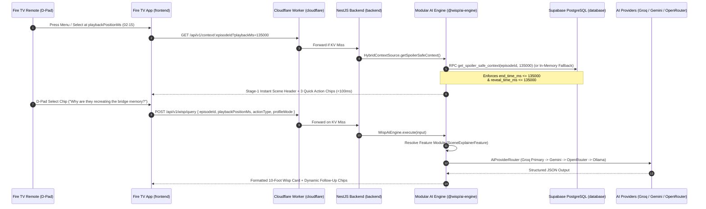

# Wisp System Architecture

## 1. End-to-End Request Flow

---

## 2. Architectural Layers & Branch Mapping

| Layer | Workspace / Directory | Dedicated Branch | Responsibility |
| :--- | :--- | :--- | :--- |
| **10-Foot TV Client** | `frontend/` | `client` | Video playback surface, D-pad focus management, Two-Stage Wisp overlay drawer, Household Profile mode switcher. |
| **Modular AI Engine** | `ai-engine/` (`@wisp/ai-engine`) | `ai-integration` | Framework-agnostic AI feature pipelines, LLM provider adapters/router, and pure-TS anti-spoiler temporal context engine (runs standalone or inside backend). |
| **Application API** | `backend/` | `server` | NestJS HTTP boundary, DTO validation, rate limiting, and Supabase wiring into `@wisp/ai-engine`. |
| **Edge Gateway & CDN** | `cloudflare/` | `server` | Cloudflare Worker KV caching by 15-second timestamp buckets, rate limiting, and R2 media streaming. |
| **Temporal Database** | `database/`, `supabase/` | `server` | 16-table PostgreSQL schema, GiST temporal exclusion constraints, pure-SQL hybrid RRF search, zero-trust RLS, and deterministic anti-spoiler RPC gateway ([`DATABASE_ARCHITECTURE.md`](./DATABASE_ARCHITECTURE.md)). |
| **Docs & Playbooks** | `docs/`, `agents/` | `docs` | Proposal, architecture, API specs, database architecture, Fire TV UX guide, Friction Log (10% bonus), and AI agent specifications. |

---

## 3. Multi-Provider AI Routing Matrix (`@wisp/ai-engine`)

| Priority | Adapter in `ai-engine` | Target Model | Role in Wisp |
| :--- | :--- | :--- | :--- |
| **1 (Primary)** | `GroqModelAdapter` | `llama-3.3-70b-versatile` | Sub-second token generation so TV remote clicks feel instantaneous. |
| **2 (Secondary)** | `GeminiModelAdapter` | `gemini-2.5-flash` | High-quota free tier with native `application/json` structured output. |
| **3 (Tertiary)** | `OpenRouterModelAdapter` | `meta-llama/llama-3.1-8b-instruct:free` | Resilient free-model fallback pool. |
| **4 (Local Dev)** | `OllamaModelAdapter` | `llama3.2:3b` | Offline development and zero-quota local verification. |

---

## 4. Production Database Architecture & Anti-Spoiler Data Engine

For full technical specifications, table DDL, mathematical proofs, and test matrices, refer to [**`docs/DATABASE_ARCHITECTURE.md`**](./DATABASE_ARCHITECTURE.md).

### 4.1 16-Table Schema Topology
The Wisp relational schema comprises 16 production tables organized across five specialized subsystems:
* **Catalog & Hierarchy (3 tables):** `programs`, `episodes`, `scene_contexts`
* **Content, Lore & Knowledge Graph (5 tables):** `transcript_segments`, `entities`, `entity_appearances`, `entity_relationships`, `episode_quizzes`
* **Vector & Semantic Search (1 table):** `temporal_embeddings`
* **Tenant, Profile & Viewing Session State (3 tables):** `profiles`, `conversation_sessions`, `interaction_history`
* **Observability, Caching & Security Telemetry (4 tables):** `ai_response_cache`, `ai_provider_metrics`, `device_rate_limits`, `spoiler_audit_log`

### 4.2 Deterministic Anti-Spoiler Boundary Invariants
All queries executed for TV viewers enforce mathematical temporal boundaries at the SQL engine level:
$$\forall s \in \text{TranscriptSegments}: \quad \text{end\_time\_ms}(s) \le T_{\text{playback}}$$
$$\forall e \in \text{UnlockedEntities}: \quad \text{reveal\_time\_ms}(e) \le T_{\text{playback}}$$
$$\forall r \in \text{UnlockedRelationships}: \quad \text{reveal\_time\_ms}(r) \le T_{\text{playback}}$$

In `scene_contexts`, continuous narrative scenes are indexed via generated `int8range(start_time_ms, end_time_ms, '[]')` columns and constrained by GiST exclusion (`excl_scene_contexts_no_overlap`), mathematically guaranteeing zero scene window collisions per episode.

### 4.3 Pure-SQL Vector Similarity & Hybrid RRF RAG Search
Rather than relying on proprietary external vector extensions, Wisp implements vector cosine similarity natively in procedural SQL (`cosine_similarity_float4`). Hybrid search fuses full-text search (`ts_rank_cd`) with dense 384-dimensional vector similarity using Reciprocal Rank Fusion:
$$\text{RRF}(d) = \frac{1}{60 + \text{rank}_{\text{lex}}(d)} + \frac{1}{60 + \text{rank}_{\text{vec}}(d)}$$
Candidate chunks are pre-filtered by the hard anti-spoiler gate (`end_time_ms <= T_playback AND reveal_time_ms <= T_playback`), preventing future plot points from ever entering LLM retrieval augmentation.

### 4.4 Zero-Trust Row-Level Security (RLS) & RPC Gateway
1. **Direct Access Revoked:** Public and authenticated client roles have direct `SELECT`, `INSERT`, `UPDATE`, and `DELETE` access revoked across all 10 spoiler-sensitive and telemetry tables.
2. **Security Definer RPCs:** All client data consumption traverses hardened `SECURITY DEFINER` stored procedures (`get_firetv_stage1_bootstrap`, `get_spoiler_safe_context`, `hybrid_spoiler_safe_rag_search`, `get_paginated_programs`).
3. **Hardware Device Isolation:** User profiles, conversation sessions, and interaction history are strictly isolated per Fire TV device through verified JWT claims (`current_trusted_device_id()`).

### 4.5 Triggers & Observability Telemetry
* **4 Trigger Functions / 14 Triggers:** Automate `updated_at`, validate child temporal bounds against `episodes.duration_ms`, prevent unsafe episode duration shrinking, and clamp any runtime AI response spoiler floor anomalies to `playback_position_ms` with automatic audit logging.
* **5 Dedicated Observability Views:** Track temporal coverage, provider performance, exact continuous latency percentiles (P50, P95, P99 via `percentile_cont()`), scene engagement hotspots, and 15-second bucket cache efficiency.

