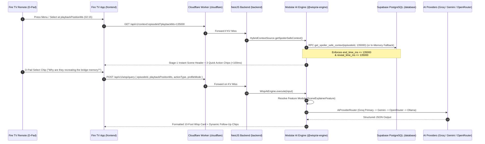

# Wisp System Architecture

## 1. End-to-End Request Flow

---

## 2. Architectural Layers & Branch Mapping

| Layer | Workspace / Directory | Dedicated Branch | Responsibility |
| :--- | :--- | :--- | :--- |
| **10-Foot TV Client** | `frontend/` | `client` | Video playback surface, D-pad focus management, Two-Stage Wisp overlay drawer, Household Profile mode switcher. |
| **Modular AI Engine** | `ai-engine/` (`@wisp/ai-engine`) | `ai-integration` | Framework-agnostic AI feature pipelines, LLM provider adapters/router, and pure-TS anti-spoiler temporal context engine (runs standalone or inside backend). |
| **Application API** | `backend/` | `server` | NestJS HTTP boundary, DTO validation, rate limiting, and Supabase wiring into `@wisp/ai-engine`. |
| **Edge Gateway & CDN** | `cloudflare/` | `server` | Cloudflare Worker KV caching by 15-second timestamp buckets, rate limiting, and R2 media streaming. |
| **Temporal Database** | `database/` | `server` | Supabase PostgreSQL schema, demo seeds, and deterministic `get_spoiler_safe_context` RPC. |
| **Docs & Playbooks** | `docs/`, `agents/` | `docs` | Proposal, architecture, API specs, Fire TV UX guide, Friction Log (10% bonus), and AI agent specifications. |

---

## 3. Multi-Provider AI Routing Matrix (`@wisp/ai-engine`)

| Priority | Adapter in `ai-engine` | Target Model | Role in Wisp |
| :--- | :--- | :--- | :--- |
| **1 (Primary)** | `GroqModelAdapter` | `llama-3.3-70b-versatile` | Sub-second token generation so TV remote clicks feel instantaneous. |
| **2 (Secondary)** | `GeminiModelAdapter` | `gemini-2.5-flash` | High-quota free tier with native `application/json` structured output. |
| **3 (Tertiary)** | `OpenRouterModelAdapter` | `meta-llama/llama-3.1-8b-instruct:free` | Resilient free-model fallback pool. |
| **4 (Local Dev)** | `OllamaModelAdapter` | `llama3.2:3b` | Offline development and zero-quota local verification. |
