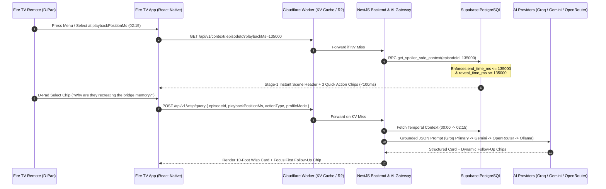

# Wisp System Architecture

## 1. End-to-End Request Flow

---

## 2. Architectural Layers

| Layer | Technology | Responsibility |
| :--- | :--- | :--- |
| **10-Foot TV Client** | React Native (`react-native-tvos`) + TS | Video playback surface, D-pad focus management, Two-Stage Wisp overlay drawer, Household Profile mode switcher. |
| **Edge Gateway & CDN** | Cloudflare Workers + KV + R2 | Edge caching by 15-second timestamp buckets, rate limiting, and zero-egress R2 streaming for open-movie demo videos. |
| **Application API & AI Gateway** | NestJS + TypeScript | Input validation, rate limiting, provider routing/fallback, prompt shaping by household profile mode, and JSON schema normalization. |
| **Temporal Context Database** | Supabase PostgreSQL | Stores programs, episodes, scenes, timestamped transcripts, progressive entity lore reveals, and deterministic anti-spoiler SQL functions. |

---

## 3. Multi-Provider AI Routing Matrix

| Priority | Provider | Target Model | Role in Wisp |
| :--- | :--- | :--- | :--- |
| **1 (Primary)** | **Groq** | `llama-3.3-70b-versatile` | Sub-second token generation so TV remote clicks feel instantaneous. |
| **2 (Secondary)** | **Google Gemini** | `gemini-2.5-flash` | High-quota free tier with native `application/json` structured output. |
| **3 (Tertiary)** | **OpenRouter** | `meta-llama/llama-3.1-8b-instruct:free` | Resilient free-model fallback pool. |
| **4 (Local Dev)** | **Ollama** | `llama3.2:3b` | Offline development and zero-quota local verification. |
