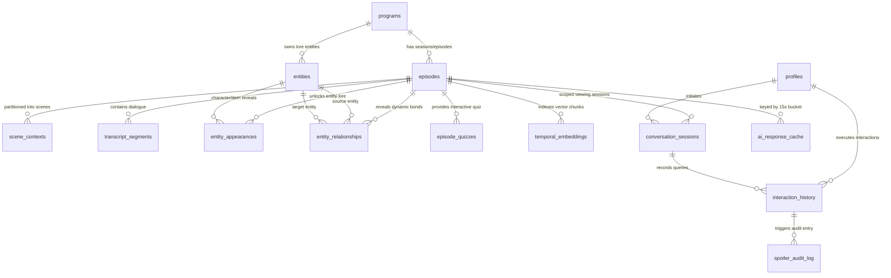

# Production Database Architecture & Anti-Spoiler Data Engine

**Wisp — AI-Powered Contextual Viewing for Amazon Fire TV**  
*Document Version:* `1.0.0-production`  
*Target Environment:* Supabase PostgreSQL 15+ / Vanilla PostgreSQL 15+  
*Database Migrations:* [`supabase/migrations/0001_initial_wisp_schema.sql`](../supabase/migrations/0001_initial_wisp_schema.sql) through [`supabase/migrations/0007_typed_catalog_pagination.sql`](../supabase/migrations/0007_typed_catalog_pagination.sql)  
*Verification Test Suite:* [`database/tests/verify_database_integrity.sql`](../database/tests/verify_database_integrity.sql)  
*Seed Catalog:* [`supabase/seed.sql`](../supabase/seed.sql)

---

## 1. System Overview & Temporal Architecture Philosophy

### 1.1 The Living Room Context Problem
In modern living room television consumption, viewers regularly lose context during narrative dramas, complex scientific documentaries, or high-stakes serialized mysteries. Traditional remedies require pausing playback, reaching for a secondary handheld device (e.g., smartphone), and conducting unconstrained internet searches. This workflow introduces two severe points of friction:
1. **The Spoiler Catastrophe:** Search engines, wikis, and fan databases index entire plot arcs, character deaths, relationship ruptures, and future narrative twists without regard for the viewer's current playback position.
2. **10-Foot Focus Disruption:** Forcing viewers away from the primary television screen breaks immersive narrative flow. Furthermore, requiring on-screen keyboard text input via a 5-way D-pad remote introduces intolerable friction.

### 1.2 The Wisp Data Engine Paradigm
Wisp resolves this dilemma by treating the **television program, current playback position ($T_{\text{playback}}$ in milliseconds), and Fire TV D-pad remote** as the atomic context interface. The database layer is not a passive object store; it is an active, deterministic **Temporal Anti-Spoiler Engine**.

```
┌──────────────────────────────────────────────────────────────────────────────────┐
│                             FIRE TV 10-FOOT CLIENT                               │
│  [ D-Pad Menu Press @ 02:15 ] ─── Stage-1 RPC (<50ms) ───> Instant Scene Drawer  │
└────────────────────────────────────────┬─────────────────────────────────────────┘
                                         │
                                         ▼
┌──────────────────────────────────────────────────────────────────────────────────┐
│                         CLOUDFLARE EDGE & NESTJS API                             │
│       Rate Limiting Check ─── JWT Device Claims ─── 15s Bucket Cache Miss        │
└────────────────────────────────────────┬─────────────────────────────────────────┘
                                         │
                                         ▼
┌──────────────────────────────────────────────────────────────────────────────────┐
│                 POSTGRESQL TEMPORAL DATA ENGINE (SUPABASE)                       │
│                                                                                  │
│   ┌──────────────────────────────────────────────────────────────────────────┐   │
│   │ Zero-Trust Security Gateway: SECURITY DEFINER RPCs + Claims Resolvers    │   │
│   └────────────────────────────────────┬─────────────────────────────────────┘   │
│                                        ▼                                         │
│   ┌──────────────────────────────────────────────────────────────────────────┐   │
│   │ Deterministic Anti-Spoiler Boundary Filter:                              │   │
│   │   • Scene Window: start_time_ms <= T_playback <= end_time_ms             │   │
│   │   • Lore Unlocks: reveal_time_ms <= T_playback                           │   │
│   │   • Transcript Gate: end_time_ms <= T_playback                           │   │
│   └────────────────────────────────────┬─────────────────────────────────────┘   │
│                                        ▼                                         │
│   ┌──────────────────────────────────────────────────────────────────────────┐   │
│   │ Pure-SQL Hybrid RRF RAG Search (Cosine Float4 + GIN Lexical ts_rank)     │   │
│   └────────────────────────────────────┬─────────────────────────────────────┘   │
│                                        ▼                                         │
│   ┌──────────────────────────────────────────────────────────────────────────┐   │
│   │ Temporal Integrity & Shrink Prevention Triggers                          │   │
│   └──────────────────────────────────────────────────────────────────────────┘   │
└────────────────────────────────────────┬─────────────────────────────────────────┘
                                         │
                                         ▼
┌──────────────────────────────────────────────────────────────────────────────────┐
│                  MODULAR AI ENGINE (@wisp/ai-engine)                             │
│   Grounds LLM (Groq Llama 3.3 / Gemini 2.5) strictly on returned context payload │
└──────────────────────────────────────────────────────────────────────────────────┘
```

### 1.3 Dual-Layer Anti-Spoiler Defense
To guarantee that plot twists are mathematically impossible to leak:
* **Layer 1 (Database Source of Truth):** PostgreSQL enforces strict temporal predicate filtering (`end_time_ms <= p_playback_ms` and `reveal_time_ms <= p_playback_ms`) inside stored procedures (`SECURITY DEFINER` RPCs). Direct table access is completely revoked from public, untrusted roles.
* **Layer 2 (In-Memory Fail-Safe):** The application layer (`@wisp/ai-engine/src/context/temporal-filter.ts`) applies an identical pure-TypeScript boundary filter prior to prompt construction, ensuring defense-in-depth even during offline or fallback operation.

---

## 2. 16-Table Schema & Entity-Relationship Architecture

The Wisp relational schema comprises **16 production tables**, organized across five cohesive subsystems:
1. **Catalog & Media Hierarchy (3 tables):** `programs`, `episodes`, `scene_contexts`
2. **Content, Lore & Knowledge Graph (5 tables):** `transcript_segments`, `entities`, `entity_appearances`, `entity_relationships`, `episode_quizzes`
3. **Vector & Semantic Search (1 table):** `temporal_embeddings`
4. **Tenant, Profile & Viewing Session State (3 tables):** `profiles`, `conversation_sessions`, `interaction_history`
5. **Observability, Caching & Security Telemetry (4 tables):** `ai_response_cache`, `ai_provider_metrics`, `device_rate_limits`, `spoiler_audit_log`

### 2.1 Entity-Relationship Diagram



---

### 2.2 Table-by-Table Technical Specifications

#### Subsystem A: Catalog & Media Hierarchy

##### 1. `programs`
Represents the top-level intellectual property (show, documentary, mini-series, or movie).
* **Primary Key:** `id` (`UUID`, default `gen_random_uuid()`)
* **Columns:**
  * `title` (`TEXT NOT NULL`): Program title.
  * `synopsis` (`TEXT NOT NULL`): Overall synopsis.
  * `genre` (`TEXT NOT NULL`): Program genre (e.g., `'Sci-Fi'`, `'Science Doc'`, `'Mystery'`).
  * `content_rating` (`TEXT NOT NULL DEFAULT 'TV-14'`): Parental advisory rating.
  * `total_seasons` (`INT NOT NULL DEFAULT 1`): Total season count.
  * `is_active` (`BOOLEAN NOT NULL DEFAULT true`): Administrative visibility toggle.
  * `is_published` (`BOOLEAN NOT NULL DEFAULT true`): Catalog publishing flag.
  * `created_at` (`TIMESTAMPTZ NOT NULL DEFAULT now()`)
  * `updated_at` (`TIMESTAMPTZ NOT NULL DEFAULT now()`)
* **Indexes:**
  * `idx_programs_active_published` on `(is_active, is_published)` (B-Tree).
  * `idx_programs_genre` on `(genre)` (B-Tree).
  * `idx_programs_created_at_id` on `(created_at DESC, id DESC)` (B-Tree cursor pagination index).
* **Triggers:** `trg_programs_set_updated_at` (`trg_fn_set_updated_at`).

##### 2. `episodes`
Represents an individual playable media asset belonging to a program.
* **Primary Key:** `id` (`UUID`, default `gen_random_uuid()`)
* **Foreign Keys:**
  * `program_id` $\rightarrow$ `programs(id)` `ON DELETE CASCADE`
* **Columns:**
  * `season_number` (`INT NOT NULL DEFAULT 1`)
  * `episode_number` (`INT NOT NULL DEFAULT 1`)
  * `title` (`TEXT NOT NULL`)
  * `synopsis` (`TEXT NOT NULL DEFAULT ''`)
  * `duration_ms` (`BIGINT NOT NULL`): Total video runtime in milliseconds (`CHECK (duration_ms > 0)`).
  * `video_stream_url` (`TEXT NOT NULL DEFAULT ''`): Cloudflare R2 / HLS playback stream URL.
  * `is_published` (`BOOLEAN NOT NULL DEFAULT true`)
  * `created_at` (`TIMESTAMPTZ NOT NULL DEFAULT now()`)
  * `updated_at` (`TIMESTAMPTZ NOT NULL DEFAULT now()`)
* **Constraints:**
  * `uq_episodes_program_season_episode` UNIQUE `(program_id, season_number, episode_number)`.
  * `chk_episodes_duration_positive` CHECK `(duration_ms > 0)`.
* **Indexes:**
  * `idx_episodes_program_id` on `(program_id)` (B-Tree).
  * `idx_episodes_program_season_ep` on `(program_id, season_number, episode_number)` (B-Tree).
* **Triggers:**
  * `trg_episodes_set_updated_at` (`trg_fn_set_updated_at`).
  * `trg_episodes_prevent_duration_shrink` (`trg_fn_prevent_unsafe_episode_duration_shrink`).

##### 3. `scene_contexts`
Partitions an episode into discrete narrative scenes. Houses pre-computed Stage-1 Quick Action Chips for the 10-foot TV UI.
* **Primary Key:** `id` (`UUID`, default `gen_random_uuid()`)
* **Foreign Keys:**
  * `episode_id` $\rightarrow$ `episodes(id)` `ON DELETE CASCADE`
* **Columns:**
  * `scene_number` (`INT NOT NULL CHECK (scene_number >= 1)`)
  * `start_time_ms` (`BIGINT NOT NULL CHECK (start_time_ms >= 0)`)
  * `end_time_ms` (`BIGINT NOT NULL CHECK (end_time_ms > start_time_ms)`)
  * `time_range` (`INT8RANGE GENERATED ALWAYS AS (int8range(start_time_ms, end_time_ms, '[]')) STORED`): **Inclusive bounds** representation for range collision checks.
  * `scene_title` (`TEXT NOT NULL`)
  * `summary` (`TEXT NOT NULL`)
  * `quick_action_chips` (`JSONB NOT NULL DEFAULT '[]'::jsonb`): 3–4 D-pad selectable prompt chips.
  * `key_events` (`TEXT[] NOT NULL DEFAULT '{}'::text[]`)
  * `visual_anchors` (`TEXT[] NOT NULL DEFAULT '{}'::text[]`)
  * `created_at` (`TIMESTAMPTZ NOT NULL DEFAULT now()`)
  * `updated_at` (`TIMESTAMPTZ NOT NULL DEFAULT now()`)
* **Constraints:**
  * `chk_scene_contexts_time_order` CHECK `(start_time_ms < end_time_ms)`.
  * `excl_scene_contexts_no_overlap` **EXCLUDE USING gist (`episode_id` WITH =, `time_range` WITH &&)**: Guarantees zero overlapping temporal scenes within the same episode.
* **Indexes:**
  * `idx_scene_contexts_episode_range` on `(episode_id, start_time_ms, end_time_ms)` (B-Tree).
  * `idx_scene_contexts_gist_timerange` USING gist on `(episode_id, time_range)`.
* **Triggers:**
  * `trg_scene_contexts_set_updated_at` (`trg_fn_set_updated_at`).
  * `trg_scene_contexts_temporal_bounds` (`trg_fn_validate_episode_temporal_bounds`).

---

#### Subsystem B: Content, Lore & Knowledge Graph

##### 4. `transcript_segments`
Stores synchronized closed caption and spoken dialogue lines.
* **Primary Key:** `id` (`UUID`, default `gen_random_uuid()`)
* **Foreign Keys:**
  * `episode_id` $\rightarrow$ `episodes(id)` `ON DELETE CASCADE`
* **Columns:**
  * `speaker` (`TEXT NOT NULL DEFAULT 'UNKNOWN'`)
  * `dialogue` (`TEXT NOT NULL`)
  * `start_time_ms` (`BIGINT NOT NULL CHECK (start_time_ms >= 0)`)
  * `end_time_ms` (`BIGINT NOT NULL CHECK (end_time_ms >= start_time_ms)`)
  * `time_range` (`INT8RANGE GENERATED ALWAYS AS (int8range(start_time_ms, end_time_ms, '[]')) STORED`)
  * `created_at` (`TIMESTAMPTZ NOT NULL DEFAULT now()`)
* **Indexes:**
  * `idx_transcript_segments_search` on `(episode_id, end_time_ms)` INCLUDE `(dialogue, speaker, start_time_ms)` (Covering index).
  * `idx_transcript_segments_trgm` USING gin on `(dialogue gin_trgm_ops)`.
  * `idx_transcript_segments_fts` USING gin on `(to_tsvector('english', dialogue))`.
* **Triggers:**
  * `trg_transcript_segments_temporal_bounds` (`trg_fn_validate_episode_temporal_bounds`).

##### 5. `entities`
Represents narrative knowledge base entities (characters, artifacts, locations, scientific concepts, factions).
* **Primary Key:** `id` (`UUID`, default `gen_random_uuid()`)
* **Foreign Keys:**
  * `program_id` $\rightarrow$ `programs(id)` `ON DELETE CASCADE`
* **Columns:**
  * `canonical_name` (`TEXT NOT NULL`)
  * `entity_type` (`entity_type_enum NOT NULL`): Custom ENUM: `'character'`, `'location'`, `'item'`, `'lore'`, `'concept'`.
  * `aliases` (`TEXT[] NOT NULL DEFAULT '{}'::text[]`)
  * `short_description` (`TEXT NOT NULL DEFAULT ''`)
  * `deep_lore` (`TEXT NOT NULL DEFAULT ''`)
  * `visual_description` (`TEXT NOT NULL DEFAULT ''`)
  * `created_at` (`TIMESTAMPTZ NOT NULL DEFAULT now()`)
  * `updated_at` (`TIMESTAMPTZ NOT NULL DEFAULT now()`)
* **Constraints:**
  * `uq_entities_program_canonical_name` UNIQUE `(program_id, canonical_name)`.
* **Indexes:**
  * `idx_entities_program_type` on `(program_id, entity_type)` (B-Tree).
  * `idx_entities_canonical_name_trgm` USING gin on `(canonical_name gin_trgm_ops)`.
* **Triggers:**
  * `trg_entities_set_updated_at` (`trg_fn_set_updated_at`).

##### 6. `entity_appearances`
Controls the progressive temporal unlocking of entity lore as an episode progresses.
* **Primary Key:** `id` (`UUID`, default `gen_random_uuid()`)
* **Foreign Keys:**
  * `entity_id` $\rightarrow$ `entities(id)` `ON DELETE CASCADE`
  * `episode_id` $\rightarrow$ `episodes(id)` `ON DELETE CASCADE`
* **Columns:**
  * `reveal_time_ms` (`BIGINT NOT NULL CHECK (reveal_time_ms >= 0)`)
  * `spoiler_tier` (`TEXT NOT NULL DEFAULT 'safe'`): e.g., `'safe'`, `'minor_twist'`, `'major_spoiler'`.
  * `contextual_note` (`TEXT NOT NULL DEFAULT ''`)
  * `created_at` (`TIMESTAMPTZ NOT NULL DEFAULT now()`)
* **Constraints:**
  * `uq_entity_appearances_reveal` UNIQUE `(entity_id, episode_id, reveal_time_ms)`.
* **Indexes:**
  * `idx_entity_appearances_lookup` on `(episode_id, reveal_time_ms, entity_id)` (B-Tree).
* **Triggers:**
  * `trg_entity_appearances_temporal_bounds` (`trg_fn_validate_episode_temporal_bounds`).

##### 7. `entity_relationships`
Models dynamic directed edges in the lore knowledge graph between two entities.
* **Primary Key:** `id` (`UUID`, default `gen_random_uuid()`)
* **Foreign Keys:**
  * `source_entity_id` $\rightarrow$ `entities(id)` `ON DELETE CASCADE`
  * `target_entity_id` $\rightarrow$ `entities(id)` `ON DELETE CASCADE`
  * `reveal_episode_id` $\rightarrow$ `episodes(id)` `ON DELETE CASCADE`
* **Columns:**
  * `relationship_type` (`TEXT NOT NULL`): e.g., `'former_lovers'`, `'creator_of'`, `'hostile_towards'`.
  * `description` (`TEXT NOT NULL DEFAULT ''`)
  * `reveal_time_ms` (`BIGINT NOT NULL CHECK (reveal_time_ms >= 0)`)
  * `created_at` (`TIMESTAMPTZ NOT NULL DEFAULT now()`)
* **Constraints:**
  * `chk_entity_relationships_no_self` CHECK `(source_entity_id <> target_entity_id)`.
  * `uq_entity_relationships_unique_edge` UNIQUE `(source_entity_id, target_entity_id, reveal_episode_id, reveal_time_ms)`.
* **Indexes:**
  * `idx_entity_relationships_reveal` on `(reveal_episode_id, reveal_time_ms)` (B-Tree).
* **Triggers:**
  * `trg_entity_relationships_temporal_bounds` (`trg_fn_validate_episode_temporal_bounds`).

##### 8. `episode_quizzes`
Stores 4-option interactive trivia questions grounded in watched scenes.
* **Primary Key:** `id` (`UUID`, default `gen_random_uuid()`)
* **Foreign Keys:**
  * `episode_id` $\rightarrow$ `episodes(id)` `ON DELETE CASCADE`
* **Columns:**
  * `question` (`TEXT NOT NULL`)
  * `options` (`JSONB NOT NULL CHECK (jsonb_typeof(options) = 'array' AND jsonb_array_length(options) = 4)`)
  * `correct_index` (`INT NOT NULL CHECK (correct_index >= 0 AND correct_index <= 3)`)
  * `explanation` (`TEXT NOT NULL DEFAULT ''`)
  * `required_watch_time_ms` (`BIGINT NOT NULL CHECK (required_watch_time_ms >= 0)`)
  * `created_at` (`TIMESTAMPTZ NOT NULL DEFAULT now()`)
* **Indexes:**
  * `idx_episode_quizzes_lookup` on `(episode_id, required_watch_time_ms)` (B-Tree).
* **Triggers:**
  * `trg_episode_quizzes_temporal_bounds` (`trg_fn_validate_episode_temporal_bounds`).

---

#### Subsystem C: Vector & Semantic Search

##### 9. `temporal_embeddings`
Stores chunked dialogue and lore text along with 384-dimensional dense semantic vector embeddings.
* **Primary Key:** `id` (`UUID`, default `gen_random_uuid()`)
* **Foreign Keys:**
  * `episode_id` $\rightarrow$ `episodes(id)` `ON DELETE CASCADE`
* **Columns:**
  * `content_type` (`TEXT NOT NULL CHECK (content_type IN ('transcript', 'scene', 'entity_lore', 'entity_note'))`)
  * `reference_id` (`UUID NOT NULL`): ID of the source entity, transcript segment, or scene.
  * `text_chunk` (`TEXT NOT NULL`)
  * `start_time_ms` (`BIGINT NOT NULL DEFAULT 0`)
  * `end_time_ms` (`BIGINT NOT NULL DEFAULT 0`)
  * `reveal_time_ms` (`BIGINT NOT NULL DEFAULT 0`)
  * `embedding` (`REAL[] NOT NULL` / `FLOAT4[] NOT NULL`): Dense 384-dimensional vector embedding.
  * `created_at` (`TIMESTAMPTZ NOT NULL DEFAULT now()`)
* **Constraints:**
  * `chk_temporal_embeddings_order` CHECK `(start_time_ms <= end_time_ms)`.
  * `chk_temporal_embeddings_dim` CHECK `(cardinality(embedding) = 384)`.
* **Indexes:**
  * `idx_temporal_embeddings_spoiler_gate` on `(episode_id, end_time_ms, reveal_time_ms)` (B-Tree).
  * `idx_temporal_embeddings_text_fts` USING gin on `(to_tsvector('english', text_chunk))`.
* **Triggers:**
  * `trg_temporal_embeddings_temporal_bounds` (`trg_fn_validate_episode_temporal_bounds`).

---

#### Subsystem D: Tenant, Profile & Viewing Session State

##### 10. `profiles`
Represents living-room household profiles (e.g., "Living Room TV", "Kids TV", "Mom & Dad").
* **Primary Key:** `id` (`UUID`, default `gen_random_uuid()`)
* **Columns:**
  * `device_id` (`TEXT NOT NULL`): Unique hardware identifier for the Fire TV stick/box.
  * `profile_name` (`TEXT NOT NULL`)
  * `mode` (`profile_mode_enum NOT NULL DEFAULT 'quick_glance'`): Custom ENUM: `'quick_glance'`, `'deep_lore'`, `'family_mode'`.
  * `is_active` (`BOOLEAN NOT NULL DEFAULT true`)
  * `created_at` (`TIMESTAMPTZ NOT NULL DEFAULT now()`)
  * `updated_at` (`TIMESTAMPTZ NOT NULL DEFAULT now()`)
* **Constraints:**
  * `uq_profiles_device_profile_name` UNIQUE `(device_id, profile_name)`.
* **Indexes:**
  * `idx_profiles_device_active` on `(device_id, is_active)` (B-Tree).
* **Triggers:**
  * `trg_profiles_set_updated_at` (`trg_fn_set_updated_at`).

##### 11. `conversation_sessions`
Tracks an ongoing viewing engagement between a profile and an episode.
* **Primary Key:** `id` (`UUID`, default `gen_random_uuid()`)
* **Foreign Keys:**
  * `profile_id` $\rightarrow$ `profiles(id)` `ON DELETE CASCADE`
  * `episode_id` $\rightarrow$ `episodes(id)` `ON DELETE CASCADE`
* **Columns:**
  * `is_active` (`BOOLEAN NOT NULL DEFAULT true`)
  * `created_at` (`TIMESTAMPTZ NOT NULL DEFAULT now()`)
  * `updated_at` (`TIMESTAMPTZ NOT NULL DEFAULT now()`)
* **Indexes:**
  * `idx_conversation_sessions_lookup` on `(profile_id, episode_id, is_active)` (B-Tree).
* **Triggers:**
  * `trg_conversation_sessions_set_updated_at` (`trg_fn_set_updated_at`).

##### 12. `interaction_history`
Maintains an immutable ledger of every AI interaction executed by a viewer.
* **Primary Key:** `id` (`UUID`, default `gen_random_uuid()`)
* **Foreign Keys:**
  * `session_id` $\rightarrow$ `conversation_sessions(id)` `ON DELETE SET NULL`
  * `profile_id` $\rightarrow$ `profiles(id)` `ON DELETE CASCADE`
* **Columns:**
  * `playback_position_ms` (`BIGINT NOT NULL CHECK (playback_position_ms >= 0)`)
  * `action_type` (`action_type_enum NOT NULL`): Custom ENUM: `'contextual_qa'`, `'entity_explain'`, `'scene_explain'`, `'episode_recap'`, `'post_watch_quiz'`.
  * `user_query` (`TEXT NOT NULL`)
  * `response_card` (`JSONB NOT NULL`): Structured JSON card payload returned to the 10-foot TV UI.
  * `latency_ms` (`INT NOT NULL DEFAULT 0`)
  * `ai_provider_used` (`TEXT NOT NULL DEFAULT 'unknown'`)
  * `spoiler_floor_verified` (`BOOLEAN NOT NULL DEFAULT true`): Verified by trigger `trg_fn_enforce_interaction_spoiler_gate`.
  * `created_at` (`TIMESTAMPTZ NOT NULL DEFAULT now()`)
* **Indexes:**
  * `idx_interaction_history_session` on `(session_id, created_at DESC)` (B-Tree).
  * `idx_interaction_history_profile` on `(profile_id, created_at DESC)` (B-Tree).
* **Triggers:**
  * `trg_interaction_history_spoiler_gate` (`trg_fn_enforce_interaction_spoiler_gate`).

---

#### Subsystem E: Observability, Caching & Security Telemetry

##### 13. `ai_response_cache`
Server-side cache keyed by 15-second timestamp buckets to maximize cache hit ratios across concurrent living rooms.
* **Primary Key:** `cache_key` (`TEXT`)
* **Foreign Keys:**
  * `episode_id` $\rightarrow$ `episodes(id)` `ON DELETE CASCADE`
* **Columns:**
  * `playback_bucket_ms` (`BIGINT NOT NULL`): Normalized to 15,000ms (`floor(playbackPositionMs / 15000) * 15000`).
  * `action_type` (`action_type_enum NOT NULL`)
  * `query_hash` (`TEXT NOT NULL`): SHA-256 digest of normalized prompt.
  * `cached_card` (`JSONB NOT NULL`)
  * `hit_count` (`INT NOT NULL DEFAULT 1`)
  * `last_hit_at` (`TIMESTAMPTZ NOT NULL DEFAULT now()`)
  * `expires_at` (`TIMESTAMPTZ NOT NULL`)
  * `created_at` (`TIMESTAMPTZ NOT NULL DEFAULT now()`)
* **Indexes:**
  * `idx_ai_response_cache_expiry` on `(expires_at)` (B-Tree).
  * `idx_ai_response_cache_lookup` on `(episode_id, playback_bucket_ms, action_type, query_hash)` (B-Tree).

##### 14. `ai_provider_metrics`
Telemetry log recording latency and token metrics across LLM providers.
* **Primary Key:** `id` (`UUID`, default `gen_random_uuid()`)
* **Columns:**
  * `provider_name` (`TEXT NOT NULL`): e.g., `'groq'`, `'gemini'`, `'openrouter'`, `'ollama'`.
  * `model_name` (`TEXT NOT NULL`): e.g., `'llama-3.3-70b-versatile'`, `'gemini-2.5-flash'`.
  * `latency_ms` (`INT NOT NULL CHECK (latency_ms >= 0)`)
  * `prompt_tokens` (`INT NOT NULL DEFAULT 0`)
  * `completion_tokens` (`INT NOT NULL DEFAULT 0`)
  * `is_success` (`BOOLEAN NOT NULL DEFAULT true`)
  * `error_code` (`TEXT`)
  * `created_at` (`TIMESTAMPTZ NOT NULL DEFAULT now()`)
* **Indexes:**
  * `idx_ai_provider_metrics_telemetry` on `(provider_name, created_at DESC)` (B-Tree).
  * `idx_ai_provider_metrics_latency` on `(provider_name, latency_ms)` (B-Tree).

##### 15. `device_rate_limits`
Sliding window rate-limiter enforcing quotas per Fire TV device.
* **Primary Key:** `device_id` (`TEXT`)
* **Columns:**
  * `request_count` (`INT NOT NULL DEFAULT 1`)
  * `window_start_at` (`TIMESTAMPTZ NOT NULL DEFAULT now()`)
  * `last_request_at` (`TIMESTAMPTZ NOT NULL DEFAULT now()`)
* **Indexes:**
  * `idx_device_rate_limits_window` on `(window_start_at)` (B-Tree).

##### 16. `spoiler_audit_log`
Security audit trail recording any attempted spoiler leakage or timestamp anomalies.
* **Primary Key:** `id` (`UUID`, default `gen_random_uuid()`)
* **Foreign Keys:**
  * `interaction_id` $\rightarrow$ `interaction_history(id)` `ON DELETE CASCADE`
* **Columns:**
  * `playback_position_ms` (`BIGINT NOT NULL`)
  * `reported_spoiler_floor_ms` (`BIGINT NOT NULL`)
  * `anomaly_type` (`TEXT NOT NULL`)
  * `details` (`JSONB NOT NULL DEFAULT '{}'::jsonb`)
  * `created_at` (`TIMESTAMPTZ NOT NULL DEFAULT now()`)
* **Indexes:**
  * `idx_spoiler_audit_log_created` on `(created_at DESC)` (B-Tree).

---

## 3. Mathematical Anti-Spoiler Invariants & Temporal Boundary Guarantees

### 3.1 Formal Mathematical Invariants

Let $T_{\text{playback}} \in \mathbb{N}_0$ be the current playback timestamp in milliseconds. For any context payload delivered to a client or LLM prompt:

$$\forall s \in \text{TranscriptSegments}: \quad \text{end\_time\_ms}(s) \le T_{\text{playback}}$$

$$\forall e \in \text{UnlockedEntities}: \quad \text{reveal\_time\_ms}(e) \le T_{\text{playback}}$$

$$\forall r \in \text{UnlockedRelationships}: \quad \text{reveal\_time\_ms}(r) \le T_{\text{playback}}$$

$$\forall q \in \text{EligibleQuizzes}: \quad \text{required\_watch\_time\_ms}(q) \le T_{\text{playback}}$$

$$\forall m \in \text{CandidateEmbeddings}: \quad \text{end\_time\_ms}(m) \le T_{\text{playback}} \quad \land \quad \text{reveal\_time\_ms}(m) \le T_{\text{playback}}$$

### 3.2 Inclusive Scene Window & GiST Range Exclusion
In `scene_contexts`, the column `time_range` is generated as:
```sql
time_range int8range GENERATED ALWAYS AS (int8range(start_time_ms, end_time_ms, '[]')) STORED
```
The constraint `excl_scene_contexts_no_overlap` enforces:
```sql
EXCLUDE USING gist (episode_id WITH =, time_range WITH &&)
```
* **Inclusive Bounds (`'[]'`):** Both `start_time_ms` and `end_time_ms` are inclusive boundaries of the scene.
* **Zero Overlap:** No two scenes for the same episode can overlap. If Scene 1 ends at $120000$, Scene 2 must start at $\ge 120001$.
* **Active Scene Resolution:**
  A scene $S$ is active if and only if:
  $$\text{start\_time\_ms}(S) \le T_{\text{playback}} \le \text{end\_time\_ms}(S)$$
  If playback falls into an unmapped inter-scene gap, the stored procedure deterministically falls back to the most recently completed scene:
  $$\arg\max_{S} \{\text{end\_time\_ms}(S) \mid \text{end\_time\_ms}(S) \le T_{\text{playback}}\}$$

### 3.3 Boundary Edge Cases
1. **$T_{\text{playback}} = 0$ (Video Start):**
   Only entities and scenes unlocked at exactly $t=0$ are visible. Dialogue lines with $\text{end\_time\_ms} > 0$ are completely excluded.
2. **$T_{\text{playback}} \ge \text{duration\_ms}$ (Post-Credits):**
   Full episode context is unlocked, and post-watch quizzes become available.
3. **Negative Timestamps ($T_{\text{playback}} < 0$):**
   The trigger and RPC validation clamp negative values to $0$ immediately, preventing arithmetic underflow or index corruption.

### 3.4 Runtime AI Response Clamping Trigger
When an AI response is recorded into `interaction_history`, the trigger `trg_fn_enforce_interaction_spoiler_gate` validates the payload's `response_card->>'spoilerSafeUpToMs'`:
```sql
IF reported_floor > playback_ms THEN
  NEW.response_card = jsonb_set(
    NEW.response_card,
    '{spoilerSafeUpToMs}',
    to_jsonb(playback_ms)
  );
  NEW.spoiler_floor_verified := false;
  INSERT INTO spoiler_audit_log (
    interaction_id, playback_position_ms, reported_spoiler_floor_ms, anomaly_type, details
  ) VALUES (
    NEW.id, playback_ms, reported_floor, 'FUTURE_SPOILER_FLOOR_CLAMPED',
    jsonb_build_object('original_reported_floor', reported_floor, 'clamped_to', playback_ms)
  );
END IF;
```

---

## 4. Stored Procedures & Database RPC Contracts

All RPC functions in Wisp are implemented with `SECURITY DEFINER` and explicitly configure `SET search_path = public` to prevent privilege escalation via malicious search path manipulation.

```
┌────────────────────────────────────────────────────────────────────────────────────────┐
│                                 RPC EXECUTION GATEWAY                                  │
├────────────────────────────────────────┬───────────────────────────────────────────────┤
│ Public / Client Exposed RPCs           │ Admin / Backend Service-Role Only RPCs        │
├────────────────────────────────────────┼───────────────────────────────────────────────┤
│ • get_firetv_stage1_bootstrap          │ • get_database_health_and_metrics             │
│ • get_spoiler_safe_context             │ • purge_expired_cache_and_rate_limits         │
│ • search_spoiler_safe_transcript       │ • upsert_ai_response_cache                    │
│ • hybrid_spoiler_safe_rag_search       │ • get_or_touch_ai_cache                       │
│ • get_cross_episode_spoiler_safe_ctx   │ • check_device_rate_limit                     │
│ • get_episode_post_watch_quiz          │ • record_wisp_interaction                     │
│ • get_paginated_programs               │                                               │
│ • delete_viewing_profile               │                                               │
└────────────────────────────────────────┴───────────────────────────────────────────────┘
```

### 4.1 Client-Facing RPCs

#### 1. `get_firetv_stage1_bootstrap`
Optimized single-roundtrip bootstrap endpoint for the Fire TV client overlay. Retrieves active device profile, current scene context, D-pad action chips, and program metadata in $<50\text{ms}$.
* **Signature:**
  ```sql
  get_firetv_stage1_bootstrap(
    p_device_id text,
    p_episode_id uuid,
    p_playback_ms bigint
  ) RETURNS jsonb
  ```
* **Security & Grants:** `SECURITY DEFINER`, granted to `anon`, `authenticated`, `service_role`.
* **Behavior:**
  * Resolves active profile for `p_device_id`. If none exists, creates default `"Living Room TV"` profile in `'quick_glance'` mode.
  * Fetches active scene where `p_playback_ms >= start_time_ms AND p_playback_ms <= end_time_ms`.
  * Returns JSON payload containing: `device_id`, `profile`, `program`, `episode`, `scene`, `quick_action_chips`, `unlocked_entities_count`, `server_timestamp`.

#### 2. `get_spoiler_safe_context`
Primary context resolver for the Stage-1 drawer and LLM grounding.
* **Signature:**
  ```sql
  get_spoiler_safe_context(
    p_episode_id uuid,
    p_playback_ms bigint
  ) RETURNS jsonb
  ```
* **Security & Grants:** `SECURITY DEFINER`, granted to `anon`, `authenticated`, `service_role`.
* **Output Payload:**
  * `scene`: Current active scene metadata (`scene_number`, `scene_title`, `summary`, `quick_action_chips`, `key_events`, `visual_anchors`).
  * `recent_dialogue`: Array of last 8 dialogue lines where `end_time_ms <= p_playback_ms`.
  * `unlocked_entities`: Array of entities revealed at or before `p_playback_ms`, with `aliases`, descriptions, and `spoiler_tier`.
  * `unlocked_relationships`: Array of active directed entity relationships revealed at or before `p_playback_ms`.
  * `metadata`: Clamped `playback_ms`, `episode_duration_ms`, `watch_percentage`.

#### 3. `search_spoiler_safe_transcript`
Lexical and trigram dialogue search bounded strictly by playback position.
* **Signature:**
  ```sql
  search_spoiler_safe_transcript(
    p_episode_id uuid,
    p_query text,
    p_playback_ms bigint,
    p_limit int DEFAULT 5
  ) RETURNS TABLE (
    id uuid,
    speaker text,
    dialogue text,
    start_time_ms bigint,
    end_time_ms bigint,
    relevance_score float8
  )
  ```
* **Security & Grants:** `SECURITY DEFINER`, granted to `anon`, `authenticated`, `service_role`.
* **Behavior:**
  * Computes relevance combining `ts_rank` on full-text search with `similarity()` from `pg_trgm`.
  * Hard gate: `WHERE episode_id = p_episode_id AND end_time_ms <= p_playback_ms`.

#### 4. `hybrid_spoiler_safe_rag_search`
Hybrid Reciprocal Rank Fusion (RRF) search fusing keyword full-text search and dense vector semantic similarity.
* **Signature:**
  ```sql
  hybrid_spoiler_safe_rag_search(
    p_episode_id uuid,
    p_query text,
    p_query_embedding float4[],
    p_playback_ms bigint,
    p_limit int DEFAULT 5,
    p_rrf_k int DEFAULT 60
  ) RETURNS TABLE (
    id uuid,
    content_type text,
    reference_id uuid,
    text_chunk text,
    start_time_ms bigint,
    end_time_ms bigint,
    reveal_time_ms bigint,
    lexical_rank int,
    vector_rank int,
    rrf_score float8
  )
  ```
* **Security & Grants:** `SECURITY DEFINER`, granted to `anon`, `authenticated`, `service_role`.

#### 5. `get_cross_episode_spoiler_safe_context`
Cross-episode context synthesizer for serialized shows. Unlocks lore from previously completed episodes plus the current episode up to $T_{\text{playback}}$.
* **Signature:**
  ```sql
  get_cross_episode_spoiler_safe_context(
    p_program_id uuid,
    p_current_episode_id uuid,
    p_playback_ms bigint,
    p_completed_episode_ids uuid[] DEFAULT '{}'::uuid[]
  ) RETURNS jsonb
  ```
* **Security & Grants:** `SECURITY DEFINER`, granted to `anon`, `authenticated`, `service_role`.

#### 6. `get_episode_post_watch_quiz`
Retrieves interactive post-watch trivia questions.
* **Signature:**
  ```sql
  get_episode_post_watch_quiz(
    p_episode_id uuid,
    p_playback_ms bigint,
    p_limit int DEFAULT 3
  ) RETURNS TABLE (
    id uuid,
    question text,
    options jsonb,
    correct_index int,
    explanation text,
    required_watch_time_ms bigint
  )
  ```
* **Security & Grants:** `SECURITY DEFINER`, granted to `anon`, `authenticated`, `service_role`.
* **Behavior:**
  * Enforces `required_watch_time_ms <= p_playback_ms`.

#### 7. `get_paginated_programs`
High-performance keyset/cursor pagination for Fire TV catalog browsing.
* **Signature:**
  ```sql
  get_paginated_programs(
    p_limit int DEFAULT 10,
    p_cursor_created_at timestamptz DEFAULT NULL,
    p_cursor_id uuid DEFAULT NULL,
    p_genre text DEFAULT NULL
  ) RETURNS TABLE (
    id uuid,
    title text,
    synopsis text,
    genre text,
    content_rating text,
    total_seasons int,
    created_at timestamptz,
    has_more boolean
  )
  ```
* **Security & Grants:** `SECURITY DEFINER`, granted to `anon`, `authenticated`, `service_role`.
* **Behavior:**
  * Uses deterministic composite cursor `(created_at, id) < (p_cursor_created_at, p_cursor_id)`.
  * Fetches `p_limit + 1` rows to calculate `has_more` without issuing an expensive `COUNT(*)` query.

#### 8. `delete_viewing_profile`
Atomically deletes a viewing profile while guarding against removing the last active profile for a hardware device.
* **Signature:**
  ```sql
  delete_viewing_profile(
    p_profile_id uuid,
    p_device_id text
  ) RETURNS jsonb
  ```
* **Security & Grants:** `SECURITY DEFINER`, granted to `anon`, `authenticated`, `service_role`.
* **Behavior:**
  * Acquires transaction-level advisory lock: `PERFORM pg_advisory_xact_lock(hashtext(p_device_id))`.
  * Verifies caller owns the profile via `p_device_id`.
  * Verifies profile count: if device has $\le 1$ profiles, throws exception code `'LAST_PROFILE'` (error: *"Cannot delete the sole profile for a device"*).
  * Automatically cascades deletion of associated conversation sessions and interaction history.

---

### 4.2 Administrative & Service-Role RPCs

#### 9. `get_database_health_and_metrics`
Comprehensive health check returning live row counts, cache hit metrics, latency percentiles, and security audit counts.
* **Signature:** `get_database_health_and_metrics() RETURNS jsonb`
* **Security & Grants:** `SECURITY DEFINER`. Access strictly revoked from `PUBLIC`, `anon`, `authenticated`. Granted exclusively to `service_role`.

#### 10. `purge_expired_cache_and_rate_limits`
Scheduled maintenance RPC purging stale cache entries and expired rate-limit windows.
* **Signature:** `purge_expired_cache_and_rate_limits() RETURNS jsonb`
* **Security & Grants:** `SECURITY DEFINER`. Granted exclusively to `service_role`.

#### 11. `record_wisp_interaction`
Atomically logs the completed AI response card, updates provider metrics, and verifies spoiler floor consistency.
* **Signature:**
  ```sql
  record_wisp_interaction(
    p_session_id uuid,
    p_profile_id uuid,
    p_playback_ms bigint,
    p_action_type action_type_enum,
    p_user_query text,
    p_response_card jsonb,
    p_latency_ms int,
    p_provider_name text,
    p_model_name text,
    p_prompt_tokens int DEFAULT 0,
    p_completion_tokens int DEFAULT 0
  ) RETURNS uuid
  ```
* **Security & Grants:** `SECURITY DEFINER`. Granted exclusively to `service_role`.

---

## 5. Pure-SQL Vector Similarity & Hybrid Reciprocal Rank Fusion (RRF)

### 5.1 Pure-SQL Vector Cosine Similarity
To ensure zero dependency on proprietary C extensions and guarantee portability across vanilla PostgreSQL and cloud providers, Wisp implements vector cosine similarity directly in PostgreSQL procedural SQL:

```sql
CREATE OR REPLACE FUNCTION cosine_similarity_float4(
  a float4[],
  b float4[]
) RETURNS float8
LANGUAGE plpgsql
IMMUTABLE PARALLEL SAFE STRICT
AS $$
DECLARE
  v_dot float8 := 0.0;
  v_norm_a float8 := 0.0;
  v_norm_b float8 := 0.0;
  v_len int;
  i int;
  val_a float8;
  val_b float8;
BEGIN
  v_len := cardinality(a);
  IF v_len IS NULL OR v_len = 0 OR v_len <> cardinality(b) THEN
    RETURN 0.0;
  END IF;

  FOR i IN 1..v_len LOOP
    val_a := a[i];
    val_b := b[i];
    v_dot := v_dot + (val_a * val_b);
    v_norm_a := v_norm_a + (val_a * val_a);
    v_norm_b := v_norm_b + (val_b * val_b);
  END LOOP;

  IF v_norm_a <= 0.0 OR v_norm_b <= 0.0 THEN
    RETURN 0.0;
  END IF;

  RETURN v_dot / (sqrt(v_norm_a) * sqrt(v_norm_b));
END;
$$;
```
* **Properties:** Marked `IMMUTABLE PARALLEL SAFE STRICT`, allowing the PostgreSQL query optimizer to parallelize scans across worker processes.
* **Robustness:** Handles zero-magnitude vectors, division-by-zero, and dimension mismatches gracefully by returning `0.0`.

### 5.2 Reciprocal Rank Fusion (RRF) Algorithm
Hybrid search fuses two distinct ranking methodologies:
1. **Lexical Full-Text Search ($R_{\text{lex}}$):** PostgreSQL English `ts_rank_cd` over `to_tsvector('english', text_chunk)`.
2. **Dense Vector Semantic Search ($R_{\text{vec}}$):** Cosine similarity between `p_query_embedding` and stored 384-dimensional `embedding`.

The composite score for document $d$ is computed as:

$$\text{RRF}(d) = \frac{1}{k + \text{rank}_{\text{lex}}(d)} + \frac{1}{k + \text{rank}_{\text{vec}}(d)}$$

Where $k$ is the smoothing constant (default $k = 60$).

```
Document Candidates (Filtered by end_time_ms <= T_playback AND reveal_time_ms <= T_playback)
   │
   ├──> Full-Text Lexical Search (ts_rank_cd) ────────> Rank_lex (1..N)
   │                                                         │
   │                                                         ▼
   │                                              RRF = 1/(60 + Rank_lex)
   │                                                    +
   │                                              RRF = 1/(60 + Rank_vec)
   │                                                         ▲
   │                                                         │
   └──> Dense Cosine Similarity (float4[]) ───────────> Rank_vec (1..N)
                                                             │
                                                             ▼
                                                Composite Top-K Candidates
```

### 5.3 Zero-Score Isolation & Text-Only Fallback
* **Relevance Isolation:** Candidate documents are only ranked if they achieve a positive match score ($\text{score}_{\text{lex}} > 0$ or $\text{score}_{\text{vec}} > 0$). Unrelated documents with zero score receive rank $0$ and are excluded from fusion.
* **Text-Only Degradation:** When `p_query_embedding` is `NULL` or empty, vector ranking is disabled. The score simplifies cleanly to:
  $$\text{RRF}(d) = \frac{1}{60 + \text{rank}_{\text{lex}}(d)}$$
  For the #1 lexical result, $\text{RRF} = \frac{1}{60 + 1} = \frac{1}{61} \approx 0.01639$.

---

## 6. Zero-Trust Row-Level Security (RLS) Model

Wisp implements a **Zero-Trust Security Boundary**. By default, all 16 tables enable Row-Level Security (`ALTER TABLE ... ENABLE ROW LEVEL SECURITY`).

### 6.1 Security Invariants
1. **Direct Access Revocation:** Direct `SELECT`, `INSERT`, `UPDATE`, and `DELETE` access is completely **REVOKED** from untrusted roles (`anon`, `authenticated`, `PUBLIC`) on all 10 spoiler-sensitive and internal tables:
   * `scene_contexts`
   * `transcript_segments`
   * `entities`
   * `entity_appearances`
   * `entity_relationships`
   * `episode_quizzes`
   * `temporal_embeddings`
   * `ai_response_cache`
   * `ai_provider_metrics`
   * `device_rate_limits`
   * `spoiler_audit_log`
2. **Deterministic RPC Gateway:** All client reads against contextual lore and transcripts MUST execute through `SECURITY DEFINER` stored procedures. Clients cannot bypass anti-spoiler filters by crafting raw SQL queries.
3. **Tenant Profile Isolation:** User data in `profiles`, `conversation_sessions`, and `interaction_history` is isolated by hardware `device_id` and `profile_id`.

### 6.2 Claims Resolvers
To decouple security logic from Supabase-specific JWT structures while supporting server-side backend queries:
* `current_trusted_device_id()`: Inspects `auth.jwt() -> 'app_metadata' ->> 'device_id'`, falling back to `current_setting('wisp.trusted_device_id', true)`. **Crucially, custom GUC settings (`wisp.*`) are honored ONLY if `is_service_role_caller()` is true**, preventing untrusted callers from forging device identities.
* `current_trusted_profile_id()`: Inspects `auth.jwt() -> 'app_metadata' ->> 'profile_id'`, falling back to `current_setting('wisp.trusted_profile_id', true)`.

### 6.3 Comprehensive RLS Policy Matrix

| Table | Policy Name | Role Scope | Allowed Operation | Using / With Check Expression |
| :--- | :--- | :--- | :--- | :--- |
| `programs` | `programs_public_read` | `anon`, `authenticated`, `service_role` | `SELECT` | `is_active = true AND is_published = true` |
| `episodes` | `episodes_public_read` | `anon`, `authenticated`, `service_role` | `SELECT` | `is_published = true AND EXISTS (SELECT 1 FROM programs p WHERE p.id = episodes.program_id AND p.is_active = true)` |
| `scene_contexts` | Direct Access Revoked | None (RPC Gateway Only) | None | Direct access denied; accessible only via `get_spoiler_safe_context` RPC. |
| `transcript_segments` | Direct Access Revoked | None (RPC Gateway Only) | None | Direct access denied; accessible only via transcript RPCs. |
| `entities` | Direct Access Revoked | None (RPC Gateway Only) | None | Direct access denied; accessible only via context RPCs. |
| `entity_appearances` | Direct Access Revoked | None (RPC Gateway Only) | None | Direct access denied; accessible only via context RPCs. |
| `entity_relationships`| Direct Access Revoked | None (RPC Gateway Only) | None | Direct access denied; accessible only via context RPCs. |
| `episode_quizzes` | Direct Access Revoked | None (RPC Gateway Only) | None | Direct access denied; accessible only via `get_episode_post_watch_quiz` RPC. |
| `temporal_embeddings`| Direct Access Revoked | None (RPC Gateway Only) | None | Direct access denied; accessible only via hybrid RAG RPC. |
| `profiles` | `profiles_device_isolation` | `anon`, `authenticated` | `SELECT`, `INSERT`, `UPDATE` | `device_id = current_trusted_device_id()` |
| `conversation_sessions`| `sessions_device_isolation` | `anon`, `authenticated` | `ALL` | `profile_id IN (SELECT id FROM profiles WHERE device_id = current_trusted_device_id())` |
| `interaction_history` | `interaction_device_isolation`| `anon`, `authenticated` | `SELECT` | `profile_id IN (SELECT id FROM profiles WHERE device_id = current_trusted_device_id())` |
| `ai_response_cache` | Service-Role Only | `service_role` | `ALL` | Access restricted strictly to server AI gateway. |
| `ai_provider_metrics`| Service-Role Only | `service_role` | `ALL` | Telemetry restricted strictly to server AI gateway. |
| `device_rate_limits` | Service-Role Only | `service_role` | `ALL` | Rate limiting enforced strictly by server AI gateway. |
| `spoiler_audit_log` | Service-Role Only | `service_role` | `ALL` | Security log accessible strictly to audit monitors. |

---

## 7. Database Triggers & Referential Invariants

The schema attaches **4 trigger functions** across **14 distinct table trigger objects**:

```
┌────────────────────────────────────────────────────────────────────────────────────────┐
│                              DATABASE TRIGGER PIPELINE                                 │
├────────────────────────────────────────────────────────────────────────────────────────┤
│ 1. Timestamp Updater (6 tables)                                                        │
│    trg_fn_set_updated_at()                                                             │
│    ├── profiles                                                                        │
│    ├── programs                                                                        │
│    ├── episodes                                                                        │
│    ├── scene_contexts                                                                  │
│    ├── entities                                                                        │
│    └── conversation_sessions                                                           │
├────────────────────────────────────────────────────────────────────────────────────────┤
│ 2. Temporal Bounds & Parent Duration Validator (6 tables)                              │
│    trg_fn_validate_episode_temporal_bounds()                                           │
│    ├── scene_contexts        (end_time_ms <= episode.duration_ms)                      │
│    ├── transcript_segments   (end_time_ms <= episode.duration_ms)                      │
│    ├── entity_appearances    (reveal_time_ms <= episode.duration_ms; Program check)    │
│    ├── entity_relationships  (reveal_time_ms <= episode.duration_ms; Program check)    │
│    ├── episode_quizzes       (required_watch_time_ms <= episode.duration_ms)           │
│    └── temporal_embeddings   (end_time_ms & reveal_time_ms <= episode.duration_ms)     │
├────────────────────────────────────────────────────────────────────────────────────────┤
│ 3. Episode Duration Shrink Preventer (1 table)                                         │
│    trg_fn_prevent_unsafe_episode_duration_shrink()                                     │
│    └── episodes              (NEW.duration_ms >= MAX(child timestamps))                │
├────────────────────────────────────────────────────────────────────────────────────────┤
│ 4. Spoiler Floor Gate & Audit Trigger (1 table)                                        │
│    trg_fn_enforce_interaction_spoiler_gate()                                           │
│    └── interaction_history   (Clamps future spoilerSafeUpToMs; logs audit anomaly)     │
└────────────────────────────────────────────────────────────────────────────────────────┘
```

### 7.1 Detailed Trigger Specifications

#### 1. `trg_fn_set_updated_at`
* **Type:** `BEFORE UPDATE`
* **Attached Tables:** `profiles`, `programs`, `episodes`, `scene_contexts`, `entities`, `conversation_sessions`.
* **Action:** Automatically updates `NEW.updated_at = now()`.

#### 2. `trg_fn_validate_episode_temporal_bounds`
* **Type:** `BEFORE INSERT OR UPDATE`
* **Attached Tables:** `scene_contexts`, `transcript_segments`, `entity_appearances`, `entity_relationships`, `episode_quizzes`, `temporal_embeddings`.
* **Guarantees:**
  * Validates that child timestamps do not exceed parent `episodes.duration_ms`.
  * For `entity_appearances`, validates that the referenced entity belongs to the same parent `program_id` as the episode.
  * For `entity_relationships`, validates that both `source_entity_id` and `target_entity_id` belong to the same program as `reveal_episode_id`.

#### 3. `trg_fn_prevent_unsafe_episode_duration_shrink`
* **Type:** `BEFORE UPDATE OF duration_ms ON episodes`
* **Guarantees:**
  * When an episode's `duration_ms` is reduced, checks existing timestamps across all child tables (`scene_contexts`, `transcript_segments`, `entity_appearances`, `episode_quizzes`, `temporal_embeddings`).
  * If `NEW.duration_ms` is smaller than any existing child timestamp, raises exception:
    `"Cannot shrink episode duration to % ms; existing child records extend to % ms"`.

#### 4. `trg_fn_enforce_interaction_spoiler_gate`
* **Type:** `BEFORE INSERT OR UPDATE ON interaction_history`
* **Guarantees:**
  * Inspects `NEW.response_card->>'spoilerSafeUpToMs'`.
  * If `spoilerSafeUpToMs > playback_position_ms`, clamps the JSON value to `playback_position_ms`, flags `spoiler_floor_verified = false`, and inserts an anomaly record into `spoiler_audit_log`.

---

## 8. Observability Views, Analytics & System Health Monitoring

Wisp defines **5 dedicated database observability views**, all secured with `REVOKE ALL FROM PUBLIC, anon, authenticated` and granted exclusively to `service_role`.

### 8.1 Production Observability Views

```
┌────────────────────────────────────────────────────────────────────────────────────────┐
│                              OBSERVABILITY VIEWS MATRIX                                │
├──────────────────────────────────────┬─────────────────────────────────────────────────┤
│ View Name                            │ Telemetry & Operational Role                    │
├──────────────────────────────────────┼─────────────────────────────────────────────────┤
│ v_episode_temporal_coverage          │ Calculates % of episode runtime covered by      │
│                                      │ scenes and transcript dialogue lines.           │
├──────────────────────────────────────┼─────────────────────────────────────────────────┤
│ v_ai_provider_performance            │ Aggregates request counts, success rates,       │
│                                      │ average latency, and token throughput per model.│
├──────────────────────────────────────┼─────────────────────────────────────────────────┤
│ v_latency_percentiles_by_provider    │ Computes exact P50, P95, and P99 latency        │
│                                      │ percentiles using percentile_cont().            │
├──────────────────────────────────────┼─────────────────────────────────────────────────┤
│ v_scene_engagement_hotspots          │ Identifies narrative scenes receiving the       │
│                                      │ highest volume of viewer AI queries.            │
├──────────────────────────────────────┼─────────────────────────────────────────────────┤
│ v_cache_efficiency_summary           │ Tracks cache hit ratios, total hits, and        │
│                                      │ active vs. expired cache entry distributions.   │
└──────────────────────────────────────┴─────────────────────────────────────────────────┘
```

#### 1. `v_episode_temporal_coverage`
Computes the percentage of total media runtime covered by scene contexts and closed caption dialogue:
```sql
SELECT
  e.id AS episode_id,
  e.title AS episode_title,
  e.duration_ms,
  COALESCE(SUM(sc.end_time_ms - sc.start_time_ms), 0) AS total_scene_coverage_ms,
  ROUND(COALESCE(SUM(sc.end_time_ms - sc.start_time_ms), 0)::numeric / e.duration_ms::numeric * 100.0, 2) AS scene_coverage_pct,
  COUNT(DISTINCT ts.id) AS transcript_segment_count
FROM episodes e
LEFT JOIN scene_contexts sc ON sc.episode_id = e.id
LEFT JOIN transcript_segments ts ON ts.episode_id = e.id
GROUP BY e.id, e.title, e.duration_ms;
```

#### 2. `v_latency_percentiles_by_provider`
Calculates exact continuous percentiles for request latencies:
```sql
SELECT
  provider_name,
  model_name,
  COUNT(*) AS sample_count,
  ROUND(percentile_cont(0.50) WITHIN GROUP (ORDER BY latency_ms)::numeric, 2) AS p50_latency_ms,
  ROUND(percentile_cont(0.95) WITHIN GROUP (ORDER BY latency_ms)::numeric, 2) AS p95_latency_ms,
  ROUND(percentile_cont(0.99) WITHIN GROUP (ORDER BY latency_ms)::numeric, 2) AS p99_latency_ms
FROM ai_provider_metrics
WHERE is_success = true
GROUP BY provider_name, model_name;
```

### 8.2 Health Monitoring RPC Payload
Calling `get_database_health_and_metrics()` as `service_role` produces a comprehensive system health report:
```json
{
  "status": "healthy",
  "checked_at": "2026-10-06T23:30:00.000Z",
  "counts": {
    "programs": 3,
    "episodes": 3,
    "scenes": 11,
    "transcripts": 35,
    "entities": 15,
    "embeddings": 12,
    "profiles": 4,
    "cached_responses": 18
  },
  "cache_performance": {
    "total_entries": 18,
    "total_hits": 142,
    "hit_ratio_pct": 88.75
  },
  "latency_p95_by_provider": [
    { "provider": "groq", "model": "llama-3.3-70b-versatile", "p95_ms": 380.0 },
    { "provider": "gemini", "model": "gemini-2.5-flash", "p95_ms": 620.0 }
  ],
  "spoiler_anomalies_detected": 0
}
```

---

## 9. Seed Dataset & 3-Genre Catalog Architecture

To demonstrate robust contextual understanding across diverse programming types, Wisp seeds three distinct demonstration programs in [`supabase/seed.sql`](../supabase/seed.sql):

```
┌────────────────────────────────────────────────────────────────────────────────────────┐
│                              3-GENRE SEED CATALOG MATRIX                               │
├─────────────────────┬──────────────────────┬────────────────────┬──────────────────────┤
│ Program Title       │ Genre                │ Episode Title      │ Runtime (ms)         │
├─────────────────────┼──────────────────────┼────────────────────┼──────────────────────┤
│ Tears of Steel      │ Sci-Fi / Narrative   │ The Amsterdam      │ 734,000 ms           │
│                     │                      │ Recalibration      │ (~12m 14s)           │
├─────────────────────┼──────────────────────┼────────────────────┼──────────────────────┤
│ Cosmic Origins:     │ Science Documentary  │ Silent Messengers  │ 1,800,000 ms         │
│ Deep Field          │                      │ of the Early Void  │ (~30m 00s)           │
├─────────────────────┼──────────────────────┼────────────────────┼──────────────────────┤
│ The Midnight Cipher │ Mystery / Noir       │ Episode 1: Echoes  │ 2,700,000 ms         │
│                     │                      │ of the Dead Drop   │ (~45m 00s)           │
└─────────────────────┴──────────────────────┴────────────────────┴──────────────────────┘
```

### 9.1 Demo Genre 1: *Tears of Steel* (Sci-Fi / Narrative Drama)
* **Program ID:** `aaaaaaaa-aaaa-aaaa-aaaa-aaaaaaaaaaa1`
* **Episode ID:** `bbbbbbbb-bbbb-bbbb-bbbb-bbbbbbbbbbb1`
* **Plot Synopsis:** In a dystopian Amsterdam, human resistance fighters barricaded inside the fortified medieval Oude Kerk attempt to save the earth from a rogue robot horde by projecting Thom into a holographic recreation of his breakup with Celia forty years prior.
* **Entities & Lore Graph:**
  * `Thom` (`character`): Former lover of Celia, undergoing memory reconstruction.
  * `Celia` (`character`): Cybernetic-augmented researcher who initiated the machine offensive after Thom mocked her robotic hand.
  * `Captain Barley` (`character`): Hardened resistance commander managing perimeter defenses.
  * `The Oude Kerk` (`location`): Fortified 14th-century church housing the holographic neural rig.
  * `Neural Memory Rig` (`item`): Quantum projection device bridging past memories.
* **Anti-Spoiler Test Timestamp ($135,000\text{ms} = 02:15$):**
  At 02:15, Thom and Celia's relationship is known, but Celia's ultimate reason for attacking humanity remains hidden until $320,000\text{ms}$.

### 9.2 Demo Genre 2: *Cosmic Origins: Deep Field* (Science Documentary)
* **Program ID:** `aaaaaaaa-aaaa-aaaa-aaaa-aaaaaaaaaaa2`
* **Episode ID:** `bbbbbbbb-bbbb-bbbb-bbbb-bbbbbbbbbbb2`
* **Content:** James Webb Space Telescope (JWST) deep field imaging, early universe cosmology, infrared spectroscopy, and gravitational lensing.
* **Entities & Lore Graph:**
  * `JWST` (`item`): Space telescope orbiting Sun-Earth L2 Lagrange point.
  * `NIRCam` (`item`): Near-Infrared Camera capturing redshifted light from early galaxies.
  * `Gravitational Lensing` (`concept`): Einsteinian warp of spacetime magnifying distant galactic clusters.
  * `Cosmic Dawn` (`lore`): Period 200–400 million years post Big Bang when the first stars ignited.
* **Anti-Spoiler Test Timestamp ($240,000\text{ms} = 04:00$):**
  Explains NIRCam without spoiling findings on high-redshift galaxy mass controversies revealed at $900,000\text{ms}$.

### 9.3 Demo Genre 3: *The Midnight Cipher* (Mystery / Noir Thriller)
* **Program ID:** `aaaaaaaa-aaaa-aaaa-aaaa-aaaaaaaaaaa3`
* **Episode ID:** `bbbbbbbb-bbbb-bbbb-bbbb-bbbbbbbbbbb3`
* **Content:** Cold War espionage, Soviet-bloc cipher machines, and double-agent defections in divided Berlin.
* **Entities & Lore Graph:**
  * `Evelyn Vance` (`character`): MI6 cryptanalyst investigating compromised embassy communications.
  * `Agent Falcon` (`character`): Elusive double-agent operating within the diplomatic corps.
  * `The Enigma-K Machine` (`item`): Modified rotor cipher apparatus.
  * `Teufelsberg Listening Post` (`location`): NSA/GCHQ radar surveillance station.
* **Anti-Spoiler Test Timestamp ($450,000\text{ms} = 07:30$):**
  Viewer can ask about the cipher machine without revealing Agent Falcon's true identity, locked until $2,100,000\text{ms}$.

---

## 10. Database Integrity Test Suite Walkthrough

The test file [`database/tests/verify_database_integrity.sql`](../database/tests/verify_database_integrity.sql) is an automated, self-contained SQL test harness executing **8 comprehensive test suites**.

### 10.1 Running the Verification Suite
To execute the test suite against a live Supabase or PostgreSQL instance:
```bash
# Via npm script
npm run test:database

# Or directly via psql CLI
psql "$DATABASE_URL" -f database/tests/verify_database_integrity.sql
```

### 10.2 Suite Breakdown

```
┌────────────────────────────────────────────────────────────────────────────────────────┐
│                          8-PART VERIFICATION TEST MATRIX                               │
├───────┬───────────────────────────────────┬────────────────────────────────────────────┤
│ Suite │ Title                             │ Validated Invariants & Assertions          │
├───────┼───────────────────────────────────┼────────────────────────────────────────────┤
│ 1     │ Schema, Tables & Constraints      │ Asserts existence of all 16 tables, 3      │
│       │                                   │ custom ENUMs, GiST exclusion constraints,  │
│       │                                   │ and generated int8range columns.           │
├───────┼───────────────────────────────────┼────────────────────────────────────────────┤
│ 2     │ Zero-Trust RLS Policies & Tenant  │ Confirms RLS enabled on all 16 tables,     │
│       │ Isolation                         │ verifies device_id row isolation, and tests│
│       │                                   │ denial of direct reads on sensitive tables.│
├───────┼───────────────────────────────────┼────────────────────────────────────────────┤
│ 3     │ Deterministic Anti-Spoiler RPC    │ Evaluates get_spoiler_safe_context at      │
│       │ Logic                             │ t=135,000ms; confirms zero leaks of future │
│       │                                   │ dialogue or unrevealed entities.           │
├───────┼───────────────────────────────────┼────────────────────────────────────────────┤
│ 4     │ Pure-SQL Cosine Similarity &      │ Verifies float4[] cosine distance, tests   │
│       │ Hybrid RRF Search                 │ RRF rank calculations, and confirms zero-  │
│       │                                   │ score isolation for unrelated queries.     │
├───────┼───────────────────────────────────┼────────────────────────────────────────────┤
│ 5     │ AI Response Cache & Rate Limiting │ Asserts 15s bucket normalization, TTL      │
│       │                                   │ expiration logic, and sliding-window rate  │
│       │                                   │ limit increments.                          │
├───────┼───────────────────────────────────┼────────────────────────────────────────────┤
│ 6     │ Database Triggers & Temporal      │ Tests duration shrink rejection, upper-    │
│       │ Bounds Enforcement                │ bound violation exceptions, and runtime    │
│       │                                   │ spoiler floor clamping with audit logging. │
├───────┼───────────────────────────────────┼────────────────────────────────────────────┤
│ 7     │ Observability Views & Health RPC  │ Queries all 5 observability views, asserts │
│       │                                   │ percentile calculations, and validates     │
│       │                                   │ get_database_health_and_metrics output.    │
├───────┼───────────────────────────────────┼────────────────────────────────────────────┤
│ 8     │ Keyset Pagination & Atomic        │ Tests get_paginated_programs cursor logic  │
│       │ Profile Deletion                  │ and delete_viewing_profile sole-profile    │
│       │                                   │ exception guard under advisory locks.      │
└───────┴───────────────────────────────────┴────────────────────────────────────────────┘
```

---

## 11. Architectural Summary & Compliance Matrix

| Architectural Invariant | Code Implementation | Verification Standard |
| :--- | :--- | :--- |
| **16 Production Tables** | `0001_initial_wisp_schema.sql` | Suite 1: All 16 tables exist with correct relational constraints. |
| **Inclusive Scene Range** | `int8range(start, end, '[]')` | `excl_scene_contexts_no_overlap` prevents scene boundary collisions. |
| **Deterministic Spoiler Gate** | `get_spoiler_safe_context()` | Suite 3: Guarantees zero records with $t > T_{\text{playback}}$. |
| **Pure-SQL Vector Search** | `cosine_similarity_float4()` | Suite 4: Vector similarity computed natively without C extensions. |
| **Reciprocal Rank Fusion** | `hybrid_spoiler_safe_rag_search()` | Fuses full-text & vector rankings with $k=60$ smoothing. |
| **Zero-Trust RLS** | `0003_security_rls_and_triggers.sql` | Suite 2: Direct reads revoked on 10 internal tables; tenant data isolated. |
| **Temporal Integrity Triggers**| 4 Trigger Functions across 14 Triggers | Suite 6: Prevents duration shrink and enforces upper temporal bounds. |
| **Observability Telemetry** | 5 Views + `get_database_health_and_metrics()` | Suite 7: Continuous P50/P95/P99 latency calculations and health telemetry. |
| **10-Foot Fast Bootstrap** | `get_firetv_stage1_bootstrap()` | Sub-50ms single roundtrip for Fire TV D-pad overlay rendering. |
