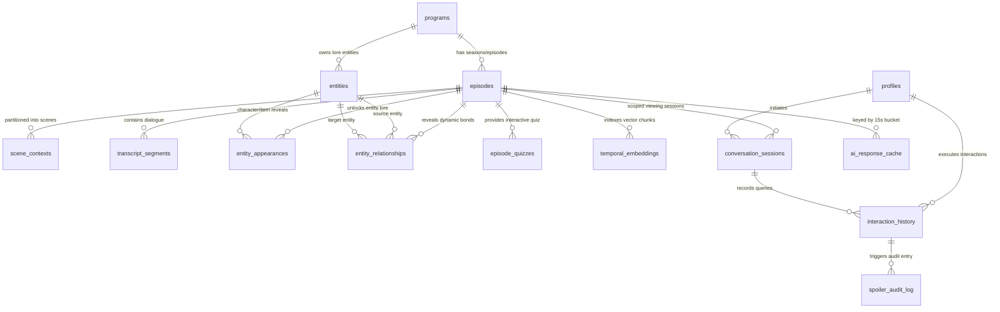

# Production Database Architecture & Anti-Spoiler Data Engine

**Wisp — AI-Powered Contextual Viewing for Amazon Fire TV**  
*Document Version:* `1.0.0-production`  
*Target Environment:* Supabase PostgreSQL 15+ / Vanilla PostgreSQL 15+  
*Database Migrations:* [`supabase/migrations/0001_initial_wisp_schema.sql`](../supabase/migrations/0001_initial_wisp_schema.sql) through [`supabase/migrations/0007_typed_catalog_pagination.sql`](../supabase/migrations/0007_typed_catalog_pagination.sql)  
*Verification Test Suite:* [`database/tests/verify_database_integrity.sql`](../database/tests/verify_database_integrity.sql)  
*Seed Catalog:* [`supabase/seed.sql`](../supabase/seed.sql)

---

## 1. System Overview & Temporal Architecture Philosophy

### 1.1 The Living Room Context Problem
In modern living room television consumption, viewers regularly lose context during narrative dramas, complex scientific documentaries, or high-stakes serialized mysteries. Traditional remedies require pausing playback, reaching for a secondary handheld device (e.g., smartphone), and conducting unconstrained internet searches. This workflow introduces two severe points of friction:
1. **The Spoiler Catastrophe:** Search engines, wikis, and fan databases index entire plot arcs, character deaths, relationship ruptures, and future narrative twists without regard for the viewer's current playback position.
2. **10-Foot Focus Disruption:** Forcing viewers away from the primary television screen breaks immersive narrative flow. Furthermore, requiring on-screen keyboard text input via a 5-way D-pad remote introduces intolerable friction.

### 1.2 The Wisp Data Engine Paradigm
Wisp resolves this dilemma by treating the **television program, current playback position ($T_{\text{playback}}$ in milliseconds), and Fire TV D-pad remote** as the atomic context interface. The database layer is not a passive object store; it is an active, deterministic **Temporal Anti-Spoiler Engine**.

```
┌──────────────────────────────────────────────────────────────────────────────────┐
│                             FIRE TV 10-FOOT CLIENT                               │
│  [ D-Pad Menu Press @ 02:15 ] ─── Stage-1 RPC (<50ms) ───> Instant Scene Drawer  │
└────────────────────────────────────────┬─────────────────────────────────────────┘
                                         │
                                         ▼
┌──────────────────────────────────────────────────────────────────────────────────┐
│                         CLOUDFLARE EDGE & NESTJS API                             │
│       Rate Limiting Check ─── JWT Device Claims ─── 15s Bucket Cache Miss        │
└────────────────────────────────────────┬─────────────────────────────────────────┘
                                         │
                                         ▼
┌──────────────────────────────────────────────────────────────────────────────────┐
│                 POSTGRESQL TEMPORAL DATA ENGINE (SUPABASE)                       │
│                                                                                  │
│   ┌──────────────────────────────────────────────────────────────────────────┐   │
│   │ Zero-Trust Security Gateway: SECURITY DEFINER RPCs + Claims Resolvers    │   │
│   └────────────────────────────────────┬─────────────────────────────────────┘   │
│                                        ▼                                         │
│   ┌──────────────────────────────────────────────────────────────────────────┐   │
│   │ Deterministic Anti-Spoiler Boundary Filter:                              │   │
│   │   • Scene Window: start_time_ms <= T_playback <= end_time_ms             │   │
│   │   • Lore Unlocks: reveal_time_ms <= T_playback                           │   │
│   │   • Transcript Gate: end_time_ms <= T_playback                           │   │
│   └────────────────────────────────────┬─────────────────────────────────────┘   │
│                                        ▼                                         │
│   ┌──────────────────────────────────────────────────────────────────────────┐   │
│   │ Pure-SQL Hybrid RRF RAG Search (Cosine Float4 + GIN Lexical ts_rank)     │   │
│   └────────────────────────────────────┬─────────────────────────────────────┘   │
│                                        ▼                                         │
│   ┌──────────────────────────────────────────────────────────────────────────┐   │
│   │ Temporal Integrity & Shrink Prevention Triggers                          │   │
│   └──────────────────────────────────────────────────────────────────────────┘   │
└────────────────────────────────────────┬─────────────────────────────────────────┘
                                         │
                                         ▼
┌──────────────────────────────────────────────────────────────────────────────────┐
│                  MODULAR AI ENGINE (@wisp/ai-engine)                             │
│   Grounds LLM (Groq Llama 3.3 / Gemini 2.5) strictly on returned context payload │
└──────────────────────────────────────────────────────────────────────────────────┘
```

### 1.3 Dual-Layer Anti-Spoiler Defense
To guarantee that plot twists are mathematically impossible to leak:
* **Layer 1 (Database Source of Truth):** PostgreSQL enforces strict temporal predicate filtering (`end_time_ms <= p_playback_ms` and `reveal_time_ms <= p_playback_ms`) inside stored procedures (`SECURITY DEFINER` RPCs). Direct table access is completely revoked from public, untrusted roles.
* **Layer 2 (In-Memory Fail-Safe):** The application layer (`@wisp/ai-engine/src/context/temporal-filter.ts`) applies an identical pure-TypeScript boundary filter prior to prompt construction, ensuring defense-in-depth even during offline or fallback operation.

### 1.4 Schema Migration Ledger & Forward Upgrade Architecture
The database is versioned across seven (7) forward-compatible migrations located in [`supabase/migrations/`](../supabase/migrations/):

| Migration File | Primary Focus | Key DDL & Architectural Invariants Landed |
| :--- | :--- | :--- |
| [`0001_initial_wisp_schema.sql`](../supabase/migrations/0001_initial_wisp_schema.sql) | Base Relational & Temporal Engine | 16 normalized tables; custom ENUMs (`household_profile_mode`, `spoiler_strictness_level`, `wisp_action_type_enum`); GiST exclusion constraint (`excl_scene_contexts_no_overlap`); covering B-tree indexes; generated weighted `tsvector` full-text search; variable-length `float4[]` vector storage. |
| [`0002_temporal_context_functions.sql`](../supabase/migrations/0002_temporal_context_functions.sql) | Anti-Spoiler Context & Rate Limiting RPCs | Initial stored procedures: `get_spoiler_safe_context`, `search_spoiler_safe_transcript`, `get_episode_post_watch_quiz`, `get_or_touch_ai_cache`, `upsert_ai_response_cache`, `check_device_rate_limit`, `record_wisp_interaction`. |
| [`0003_security_rls_and_triggers.sql`](../supabase/migrations/0003_security_rls_and_triggers.sql) | Zero-Trust RLS, JWT Claims & Triggers | Preflight dependency assertions; RLS enabled on all 16 tables; JWT device claim resolvers (`current_trusted_device_id`, `current_trusted_profile_id`); 4 trigger functions across 14 tables (temporal boundary guards, duration shrink prevention, and runtime spoiler floor clamping). |
| [`0004_analytics_views_and_observability.sql`](../supabase/migrations/0004_analytics_views_and_observability.sql) | Observability Views & Health RPC | 5 secured views (`v_episode_temporal_coverage`, `v_ai_provider_performance`, `v_latency_percentiles_by_provider` with `percentile_cont`, `v_scene_engagement_hotspots`, `v_cache_efficiency_summary`); `get_database_health_and_metrics` and `purge_expired_cache_and_rate_limits` RPCs. |
| [`0005_hybrid_rag_and_cross_episode_context.sql`](../supabase/migrations/0005_hybrid_rag_and_cross_episode_context.sql) | Pure-SQL Vector Similarity & RRF RAG | Pure-SQL `cosine_similarity_float4`; Reciprocal Rank Fusion `hybrid_spoiler_safe_rag_search`; `get_cross_episode_spoiler_safe_context`; single-roundtrip Fire TV overlay bootstrap `get_firetv_stage1_bootstrap`. |
| [`0006_atomic_profile_deletion.sql`](../supabase/migrations/0006_atomic_profile_deletion.sql) | Transactional Profile Deletion | Distributed-safe `delete_viewing_profile` RPC with `pg_advisory_xact_lock`, row-level `FOR UPDATE` locking across device profiles, sole-profile retention safety, and strict `service_role` grant. |
| [`0007_typed_catalog_pagination.sql`](../supabase/migrations/0007_typed_catalog_pagination.sql) | Typed Catalog Cursor Pagination | `get_paginated_programs` RPC with typed SQL evaluation, replacing raw PostgREST filter string interpolation with SQL-level parameterization. |

---

## 2. 16-Table Schema & Entity-Relationship Architecture

The Wisp relational schema comprises **16 production tables**, organized across five cohesive subsystems:
1. **Catalog & Media Hierarchy (3 tables):** `programs`, `episodes`, `scene_contexts`
2. **Content, Lore & Knowledge Graph (5 tables):** `transcript_segments`, `entities`, `entity_appearances`, `entity_relationships`, `episode_quizzes`
3. **Vector & Semantic Search (1 table):** `temporal_embeddings`
4. **Tenant, Profile & Viewing Session State (3 tables):** `profiles`, `conversation_sessions`, `interaction_history`
5. **Observability, Caching & Security Telemetry (4 tables):** `ai_response_cache`, `ai_provider_metrics`, `device_rate_limits`, `spoiler_audit_log`

### 2.1 Entity-Relationship Diagram



---

### 2.2 Table-by-Table Technical Specifications

#### Subsystem A: Catalog & Media Hierarchy

##### 1. `programs`
Represents top-level television series, films, and documentaries available in the Wisp catalog.
* **Primary Key:** `id` (`UUID`, default `gen_random_uuid()`)
* **Columns:**
  * `slug` (`TEXT UNIQUE NOT NULL CHECK (slug ~ '^[a-z0-9]+(?:-[a-z0-9]+)*$')`): Kebab-case URL identifier.
  * `title` (`TEXT NOT NULL CHECK (char_length(btrim(title)) >= 1)`): Program title.
  * `genre` (`TEXT NOT NULL CHECK (char_length(btrim(genre)) >= 1)`): Program genre (e.g., `'Sci-Fi'`, `'Science Documentary'`, `'Mystery'`).
  * `synopsis` (`TEXT NOT NULL CHECK (char_length(btrim(synopsis)) >= 10)`): Overall program synopsis.
  * `release_year` (`INTEGER CHECK (release_year IS NULL OR (release_year BETWEEN 1900 AND 2100))`): Initial release year.
  * `rating` (`TEXT NOT NULL DEFAULT 'TV-PG' CHECK (rating IN ('TV-Y', 'TV-Y7', 'TV-G', 'TV-PG', 'TV-14', 'TV-MA', 'G', 'PG', 'PG-13', 'R', 'NR'))`): Content advisory rating.
  * `content_advisories` (`TEXT[] NOT NULL DEFAULT '{}'::text[]`): Specific advisory tags (e.g., `{"violence", "mild language"}`).
  * `original_language` (`TEXT NOT NULL DEFAULT 'en'`): ISO-639-1 primary language code.
  * `total_seasons` (`INTEGER NOT NULL DEFAULT 1 CHECK (total_seasons >= 1)`): Total seasons produced.
  * `poster_url` (`TEXT`): Portrait poster image URL.
  * `backdrop_url` (`TEXT`): 16:9 landscape backdrop image URL.
  * `license_info` (`TEXT NOT NULL DEFAULT 'CC-BY / Public Domain'`): Content licensing metadata.
  * `is_active` (`BOOLEAN NOT NULL DEFAULT true`): Catalog visibility toggle.
  * `created_at` (`TIMESTAMPTZ NOT NULL DEFAULT now()`)
  * `updated_at` (`TIMESTAMPTZ NOT NULL DEFAULT now()`)
* **Indexes:**
  * `idx_programs_genre_active` on `(genre, is_active)` WHERE `is_active = true` (B-Tree).
  * `idx_programs_title_trgm` USING gin on `(title gin_trgm_ops)` (GIN Trigram).
* **Triggers:** `trg_programs_set_updated_at` (`trg_fn_set_updated_at`).

##### 2. `episodes`
Represents an individual playable media asset belonging to a program.
* **Primary Key:** `id` (`UUID`, default `gen_random_uuid()`)
* **Foreign Keys:**
  * `program_id` $\rightarrow$ `programs(id)` `ON DELETE CASCADE`
* **Columns:**
  * `season_number` (`INTEGER NOT NULL DEFAULT 1 CHECK (season_number >= 1)`)
  * `episode_number` (`INTEGER NOT NULL DEFAULT 1 CHECK (episode_number >= 1)`)
  * `title` (`TEXT NOT NULL CHECK (char_length(btrim(title)) >= 1)`)
  * `summary` (`TEXT NOT NULL CHECK (char_length(btrim(summary)) >= 10)`)
  * `duration_ms` (`BIGINT NOT NULL CHECK (duration_ms > 0)`): Total video runtime in milliseconds.
  * `intro_end_ms` (`BIGINT NOT NULL DEFAULT 0 CHECK (intro_end_ms >= 0 AND intro_end_ms <= duration_ms)`): Intro sequence boundary.
  * `credits_start_ms` (`BIGINT CHECK (credits_start_ms IS NULL OR (credits_start_ms >= 0 AND credits_start_ms <= duration_ms))`): End credits start timestamp (triggers post-watch trivia chip).
  * `default_bucket_sec` (`INTEGER NOT NULL DEFAULT 15 CHECK (default_bucket_sec BETWEEN 5 AND 60)`): AI response cache bucket normalization size in seconds.
  * `video_stream_url` (`TEXT NOT NULL CHECK (char_length(btrim(video_stream_url)) >= 8)`): HLS / Cloudflare R2 / MP4 video stream URL.
  * `subtitle_vtt_url` (`TEXT`): WebVTT subtitle stream URL.
  * `thumbnail_sprite_url` (`TEXT`): Fast-forward scrubbing thumbnail sprite sheet URL.
  * `is_published` (`BOOLEAN NOT NULL DEFAULT true`): Availability flag.
  * `created_at` (`TIMESTAMPTZ NOT NULL DEFAULT now()`)
  * `updated_at` (`TIMESTAMPTZ NOT NULL DEFAULT now()`)
* **Constraints:**
  * `uq_episodes_program_season_episode` UNIQUE `(program_id, season_number, episode_number)`.
  * `episodes_intro_end_ms_bounds_check` CHECK `(intro_end_ms >= 0 AND intro_end_ms <= duration_ms)`.
  * `episodes_credits_start_ms_bounds_check` CHECK `(credits_start_ms IS NULL OR (credits_start_ms >= 0 AND credits_start_ms <= duration_ms))`.
* **Indexes:**
  * `idx_episodes_program_lookup` on `(program_id, season_number, episode_number)` INCLUDE `(title, duration_ms, is_published)` (B-Tree covering index).
* **Triggers:**
  * `trg_episodes_set_updated_at` (`trg_fn_set_updated_at`).
  * `trg_episodes_prevent_duration_shrink` (`trg_fn_prevent_unsafe_episode_duration_shrink`).

##### 3. `scene_contexts`
Partitions an episode into discrete narrative scenes. Houses pre-computed Stage-1 Quick Action Chips for the 10-foot TV UI.
* **Primary Key:** `id` (`UUID`, default `gen_random_uuid()`)
* **Foreign Keys:**
  * `episode_id` $\rightarrow$ `episodes(id)` `ON DELETE CASCADE`
* **Columns:**
  * `scene_index` (`INTEGER NOT NULL CHECK (scene_index >= 1)`): 1-based sequential scene index.
  * `start_time_ms` (`BIGINT NOT NULL CHECK (start_time_ms >= 0)`)
  * `end_time_ms` (`BIGINT NOT NULL CHECK (end_time_ms > start_time_ms)`)
  * `time_range` (`INT8RANGE GENERATED ALWAYS AS (int8range(start_time_ms, end_time_ms, '[]')) STORED`): **Inclusive bounds** range representation used for $O(\log N)$ GiST point containment queries (`playback_ms <@ time_range`).
  * `scene_title` (`TEXT NOT NULL CHECK (char_length(btrim(scene_title)) >= 1)`)
  * `location_name` (`TEXT`): Setting or geographical environment.
  * `mood_tag` (`TEXT NOT NULL DEFAULT 'narrative'`): Atmospheric tone tag (`'tense'`, `'mysterious'`, `'action'`).
  * `narrative_tension_score` (`SMALLINT NOT NULL DEFAULT 5 CHECK (narrative_tension_score BETWEEN 1 AND 10)`): Tension rating for AI tone calibration.
  * `spoiler_safe_summary` (`TEXT NOT NULL CHECK (char_length(btrim(spoiler_safe_summary)) >= 5)`): High-level spoiler-free summary of active scene.
  * `quick_action_chips` (`JSONB NOT NULL DEFAULT '[]'::jsonb CHECK (jsonb_typeof(quick_action_chips) = 'array')`): 2–4 D-pad selectable prompt chips for zero-typing 10-foot interaction.
  * `created_at` (`TIMESTAMPTZ NOT NULL DEFAULT now()`)
  * `updated_at` (`TIMESTAMPTZ NOT NULL DEFAULT now()`)
* **Constraints:**
  * UNIQUE `(episode_id, scene_index)`.
  * `excl_scene_contexts_no_overlap` **EXCLUDE USING gist (`episode_id` WITH =, `time_range` WITH &&)**: Mathematically guarantees zero overlapping temporal scenes within the same episode.
* **Indexes:**
  * `idx_scene_contexts_temporal` on `(episode_id, start_time_ms, end_time_ms)` INCLUDE `(scene_index, scene_title, location_name, mood_tag, narrative_tension_score, spoiler_safe_summary, quick_action_chips)` (Covering index for Index-Only Scans).
  * `idx_scene_contexts_timerange_gist` USING gist on `(episode_id, time_range)`.
  * `idx_scene_contexts_chips_gin` USING gin on `(quick_action_chips)`.
* **Triggers:**
  * `trg_scene_contexts_set_updated_at` (`trg_fn_set_updated_at`).
  * `trg_scene_contexts_temporal_bounds` (`trg_fn_validate_episode_temporal_bounds`).

---

#### Subsystem B: Content, Lore & Knowledge Graph

##### 4. `transcript_segments`
Stores synchronized dialogue lines, speaker identification, and visual scene cues.
* **Primary Key:** `id` (`UUID`, default `gen_random_uuid()`)
* **Foreign Keys:**
  * `episode_id` $\rightarrow$ `episodes(id)` `ON DELETE CASCADE`
* **Columns:**
  * `start_time_ms` (`BIGINT NOT NULL CHECK (start_time_ms >= 0)`)
  * `end_time_ms` (`BIGINT NOT NULL CHECK (end_time_ms >= start_time_ms)`): **Hard anti-spoiler gate:** a dialogue line is unlocked only after the viewer reaches `end_time_ms`.
  * `time_range` (`INT8RANGE GENERATED ALWAYS AS (int8range(start_time_ms, end_time_ms, '[]')) STORED`)
  * `speaker_name` (`TEXT`): Speaking character or narrator name.
  * `dialogue_text` (`TEXT NOT NULL CHECK (char_length(btrim(dialogue_text)) >= 1)`)
  * `visual_cue` (`TEXT`): Visual scene or non-verbal action description.
  * `confidence_score` (`NUMERIC(4,3) NOT NULL DEFAULT 1.000 CHECK (confidence_score BETWEEN 0.000 AND 1.000)`): ASR / transcription confidence.
  * `is_key_plot_point` (`BOOLEAN NOT NULL DEFAULT false`): High-importance flag for accelerated recap generation.
  * `search_vector` (`TSVECTOR GENERATED ALWAYS AS (...) STORED`): Weighted full-text search vector: Speaker (`'A'`), Dialogue (`'B'`), Visual Cue (`'C'`).
  * `created_at` (`TIMESTAMPTZ NOT NULL DEFAULT now()`)
* **Indexes:**
  * `idx_transcript_segments_temporal` on `(episode_id, end_time_ms, start_time_ms)` INCLUDE `(speaker_name, dialogue_text, visual_cue, is_key_plot_point)` (Covering index).
  * `idx_transcript_segments_key_plot_partial` on `(episode_id, end_time_ms)` INCLUDE `(speaker_name, dialogue_text, visual_cue)` WHERE `is_key_plot_point = true`.
  * `idx_transcript_segments_fts` USING gin on `(search_vector)`.
  * `idx_transcript_segments_dialogue_trgm` USING gin on `(dialogue_text gin_trgm_ops)`.
* **Triggers:**
  * `trg_transcript_segments_temporal_bounds` (`trg_fn_validate_episode_temporal_bounds`).

##### 5. `entities`
Canonical registry of characters, locations, scientific concepts, objects, and factions per program.
* **Primary Key:** `id` (`UUID`, default `gen_random_uuid()`)
* **Foreign Keys:**
  * `program_id` $\rightarrow$ `programs(id)` `ON DELETE CASCADE`
* **Columns:**
  * `slug` (`TEXT NOT NULL CHECK (slug ~ '^[a-z0-9]+(?:-[a-z0-9]+)*$')`): Kebab-case canonical entity identifier.
  * `name` (`TEXT NOT NULL CHECK (char_length(btrim(name)) >= 1)`): Primary display name.
  * `aliases` (`TEXT[] NOT NULL DEFAULT '{}'::text[]`): Alternate character aliases, nicknames, codenames.
  * `entity_type` (`TEXT NOT NULL CHECK (entity_type IN ('character', 'location', 'concept', 'object', 'faction'))`): Entity classification.
  * `base_description` (`TEXT NOT NULL CHECK (char_length(btrim(base_description)) >= 5)`): High-level spoiler-free baseline summary.
  * `spoiler_floor_ms` (`BIGINT NOT NULL DEFAULT 0 CHECK (spoiler_floor_ms >= 0)`): Minimum timestamp before this entity's existence may be revealed.
  * `avatar_url` (`TEXT`): Entity thumbnail image URL.
  * `created_at` (`TIMESTAMPTZ NOT NULL DEFAULT now()`)
  * `updated_at` (`TIMESTAMPTZ NOT NULL DEFAULT now()`)
* **Constraints:**
  * UNIQUE `(program_id, slug)`.
* **Indexes:**
  * `idx_entities_program_type` on `(program_id, entity_type)` INCLUDE `(slug, name, base_description, spoiler_floor_ms)` (Covering index).
  * `idx_entities_name_trgm` USING gin on `(name gin_trgm_ops)`.
* **Triggers:**
  * `trg_entities_set_updated_at` (`trg_fn_set_updated_at`).

##### 6. `entity_appearances`
Controls the progressive temporal unlocking of entity lore facts as an episode progresses.
* **Primary Key:** `id` (`UUID`, default `gen_random_uuid()`)
* **Foreign Keys:**
  * `episode_id` $\rightarrow$ `episodes(id)` `ON DELETE CASCADE`
  * `entity_id` $\rightarrow$ `entities(id)` `ON DELETE CASCADE`
* **Columns:**
  * `start_time_ms` (`BIGINT NOT NULL CHECK (start_time_ms >= 0)`)
  * `end_time_ms` (`BIGINT NOT NULL CHECK (end_time_ms >= start_time_ms)`)
  * `reveal_time_ms` (`BIGINT NOT NULL DEFAULT 0 CHECK (reveal_time_ms >= 0)`): **Hard anti-spoiler gate:** progressive fact is unlocked only when `reveal_time_ms <= playback_position_ms`.
  * `progressive_fact` (`TEXT NOT NULL CHECK (char_length(btrim(progressive_fact)) >= 5)`): Contextual lore detail revealed at `reveal_time_ms`.
  * `is_plot_twist` (`BOOLEAN NOT NULL DEFAULT false`): Indicates a major narrative twist or identity reveal.
  * `importance_rank` (`SMALLINT NOT NULL DEFAULT 1 CHECK (importance_rank BETWEEN 1 AND 10)`): Lore significance weight.
  * `created_at` (`TIMESTAMPTZ NOT NULL DEFAULT now()`)
* **Indexes:**
  * `idx_entity_appearances_temporal` on `(episode_id, reveal_time_ms, start_time_ms, end_time_ms)` INCLUDE `(entity_id, progressive_fact, is_plot_twist, importance_rank)`.
  * `idx_entity_appearances_entity_lookup` on `(entity_id, episode_id, reveal_time_ms)`.
  * `idx_entity_appearances_twists_partial` on `(episode_id, reveal_time_ms)` WHERE `is_plot_twist = true`.
* **Triggers:**
  * `trg_entity_appearances_temporal_bounds` (`trg_fn_validate_episode_temporal_bounds`).

##### 7. `entity_relationships`
Models dynamic directed edges in the lore knowledge graph between two entities, gated by reveal time.
* **Primary Key:** `id` (`UUID`, default `gen_random_uuid()`)
* **Foreign Keys:**
  * `episode_id` $\rightarrow$ `episodes(id)` `ON DELETE CASCADE`
  * `source_entity_id` $\rightarrow$ `entities(id)` `ON DELETE CASCADE`
  * `target_entity_id` $\rightarrow$ `entities(id)` `ON DELETE CASCADE`
* **Columns:**
  * `relationship_type` (`TEXT NOT NULL CHECK (char_length(btrim(relationship_type)) >= 2)`): e.g., `'former_lovers'`, `'creator_of'`, `'hostile_towards'`.
  * `relationship_summary` (`TEXT NOT NULL CHECK (char_length(btrim(relationship_summary)) >= 5)`): Description of the relationship.
  * `reveal_time_ms` (`BIGINT NOT NULL DEFAULT 0 CHECK (reveal_time_ms >= 0)`): **Hard anti-spoiler gate:** edge unlocked only when `reveal_time_ms <= playback_position_ms`.
  * `valid_from_ms` (`BIGINT NOT NULL DEFAULT 0 CHECK (valid_from_ms >= 0)`): Relationship state start timestamp.
  * `valid_until_ms` (`BIGINT CHECK (valid_until_ms IS NULL OR valid_until_ms >= valid_from_ms)`): Relationship state expiration timestamp (supports evolving dynamics, e.g. allies turning into adversaries).
  * `is_secret_reveal` (`BOOLEAN NOT NULL DEFAULT false`): Sensitive relationship flag.
  * `created_at` (`TIMESTAMPTZ NOT NULL DEFAULT now()`)
* **Constraints:**
  * CHECK `(source_entity_id <> target_entity_id)`: Prevents self-relationships.
* **Indexes:**
  * `idx_entity_relationships_temporal` on `(episode_id, reveal_time_ms, source_entity_id, target_entity_id)` INCLUDE `(relationship_type, relationship_summary, valid_from_ms, valid_until_ms)`.
* **Triggers:**
  * `trg_entity_relationships_temporal_bounds` (`trg_fn_validate_episode_temporal_bounds`).

##### 8. `episode_quizzes`
Stores curated, spoiler-safe multiple-choice trivia questions unlocked only when playback passes `unlock_time_ms`.
* **Primary Key:** `id` (`UUID`, default `gen_random_uuid()`)
* **Foreign Keys:**
  * `episode_id` $\rightarrow$ `episodes(id)` `ON DELETE CASCADE`
* **Columns:**
  * `unlock_time_ms` (`BIGINT NOT NULL DEFAULT 0 CHECK (unlock_time_ms >= 0)`): Minimum playback timestamp before this question becomes available.
  * `profile_mode` (`household_profile_mode NOT NULL DEFAULT 'quick_glance'`): Custom ENUM: `'quick_glance'`, `'deep_lore'`, `'family_friendly'`.
  * `difficulty_level` (`TEXT NOT NULL DEFAULT 'medium' CHECK (difficulty_level IN ('easy', 'medium', 'hard'))`)
  * `question_text` (`TEXT NOT NULL CHECK (char_length(btrim(question_text)) >= 10)`)
  * `options` (`JSONB NOT NULL CHECK (jsonb_typeof(options) = 'array' AND jsonb_array_length(options) BETWEEN 2 AND 6)`): 2 to 6 multiple-choice answers.
  * `correct_option_index` (`SMALLINT NOT NULL CHECK (correct_option_index BETWEEN 0 AND 5)`): 0-indexed correct option.
  * `explanation_text` (`TEXT NOT NULL CHECK (char_length(btrim(explanation_text)) >= 5)`): Post-answer explanation.
  * `created_at` (`TIMESTAMPTZ NOT NULL DEFAULT now()`)
* **Indexes:**
  * `idx_episode_quizzes_temporal` on `(episode_id, unlock_time_ms, profile_mode)` INCLUDE `(difficulty_level, question_text, options, correct_option_index, explanation_text)`.
* **Triggers:**
  * `trg_episode_quizzes_temporal_bounds` (`trg_fn_validate_episode_temporal_bounds`).

---

#### Subsystem C: Vector & Semantic Search

##### 9. `temporal_embeddings`
Stores chunked dialogue and lore text along with dense semantic vector embeddings supporting Hybrid Reciprocal Rank Fusion (RRF) RAG retrieval.
* **Primary Key:** `id` (`UUID`, default `gen_random_uuid()`)
* **Foreign Keys:**
  * `episode_id` $\rightarrow$ `episodes(id)` `ON DELETE CASCADE`
* **Columns:**
  * `source_type` (`TEXT NOT NULL CHECK (source_type IN ('transcript', 'scene_summary', 'entity_lore'))`): Originating chunk type.
  * `source_ref_id` (`UUID`): Optional reference to the underlying entity, transcript segment, or scene.
  * `start_time_ms` (`BIGINT NOT NULL DEFAULT 0 CHECK (start_time_ms >= 0)`)
  * `end_time_ms` (`BIGINT NOT NULL CHECK (end_time_ms >= start_time_ms)`)
  * `reveal_time_ms` (`BIGINT NOT NULL DEFAULT 0 CHECK (reveal_time_ms >= 0)`): Combined anti-spoiler gate (`end_time_ms <= playback_ms AND reveal_time_ms <= playback_ms`).
  * `content_text` (`TEXT NOT NULL CHECK (char_length(btrim(content_text)) >= 5)`): Text chunk for search.
  * `embedding_model` (`TEXT NOT NULL DEFAULT 'text-embedding-3-small-8d'`): Embedding model identifier.
  * `embedding_vector` (`FLOAT4[] NOT NULL CHECK (cardinality(embedding_vector) >= 4)`): Dense vector embedding stored in native PostgreSQL `float4[]`. Enforces variable-length vectors with a minimum dimension of 4 (production models use 384-d, test seed uses 8-d).
  * `search_vector` (`TSVECTOR GENERATED ALWAYS AS (to_tsvector('english', coalesce(content_text, ''))) STORED`): Generated full-text search vector.
  * `created_at` (`TIMESTAMPTZ NOT NULL DEFAULT now()`)
* **Constraints:**
  * `chk_temporal_embeddings_order` CHECK `(start_time_ms <= end_time_ms)`.
  * `chk_temporal_embeddings_dim` CHECK `(cardinality(embedding_vector) >= 4)`.
* **Indexes:**
  * `idx_temporal_embeddings_gate` on `(episode_id, end_time_ms, reveal_time_ms)` INCLUDE `(source_type, content_text, embedding_vector)` (Covering index for gated retrieval).
  * `idx_temporal_embeddings_fts` USING gin on `(search_vector)`.
* **Triggers:**
  * `trg_temporal_embeddings_temporal_bounds` (`trg_fn_validate_episode_temporal_bounds`).

---

#### Subsystem D: Tenant, Profile & Viewing Session State

##### 10. `profiles`
Represents living-room household viewing profiles (e.g., "Living Room TV", "Kids TV", "Mom & Dad") controlling AI explanation depth, TTS narration, and spoiler strictness.
* **Primary Key:** `id` (`UUID`, default `gen_random_uuid()`)
* **Columns:**
  * `device_id` (`TEXT NOT NULL CHECK (char_length(btrim(device_id)) >= 3)`): Hardware identifier for the Amazon Fire TV device.
  * `display_name` (`TEXT NOT NULL CHECK (char_length(btrim(display_name)) BETWEEN 1 AND 80)`): Profile name.
  * `mode` (`household_profile_mode NOT NULL DEFAULT 'quick_glance'`): Custom ENUM: `'quick_glance'`, `'deep_lore'`, `'family_friendly'`.
  * `spoiler_strictness` (`TEXT NOT NULL DEFAULT 'strict' CHECK (spoiler_strictness IN ('strict', 'moderate', 'relaxed'))`): Boundary tolerance.
  * `preferred_language` (`TEXT NOT NULL DEFAULT 'en' CHECK (char_length(btrim(preferred_language)) BETWEEN 2 AND 10)`): ISO language code.
  * `voice_tts_enabled` (`BOOLEAN NOT NULL DEFAULT true`): Audio TTS narration toggle.
  * `auto_pause_on_overlay` (`BOOLEAN NOT NULL DEFAULT false`): Video auto-pause behavior when opening overlay.
  * `parental_pin_hash` (`TEXT`): Cryptographic hash for parental controls.
  * `total_queries_count` (`BIGINT NOT NULL DEFAULT 0 CHECK (total_queries_count >= 0)`): Interaction usage counter.
  * `last_active_at` (`TIMESTAMPTZ NOT NULL DEFAULT now()`)
  * `created_at` (`TIMESTAMPTZ NOT NULL DEFAULT now()`)
  * `updated_at` (`TIMESTAMPTZ NOT NULL DEFAULT now()`)
* **Constraints:**
  * UNIQUE `(device_id, display_name)`.
* **Indexes:**
  * `idx_profiles_device_id` on `(device_id)` INCLUDE `(display_name, mode, spoiler_strictness, voice_tts_enabled)` (Covering index).
* **Triggers:**
  * `trg_profiles_set_updated_at` (`trg_fn_set_updated_at`).

##### 11. `conversation_sessions`
Short-lived multi-turn conversation state and viewer bookmarks per Fire TV device and episode.
* **Primary Key:** `id` (`UUID`, default `gen_random_uuid()`)
* **Foreign Keys:**
  * `profile_id` $\rightarrow$ `profiles(id)` `ON DELETE SET NULL`
  * `episode_id` $\rightarrow$ `episodes(id)` `ON DELETE CASCADE`
* **Columns:**
  * `device_id` (`TEXT NOT NULL CHECK (char_length(btrim(device_id)) >= 3)`): Fire TV hardware identifier.
  * `last_playback_position_ms` (`BIGINT NOT NULL DEFAULT 0 CHECK (last_playback_position_ms >= 0)`): Bookmarked playback head.
  * `turn_count` (`INTEGER NOT NULL DEFAULT 0 CHECK (turn_count >= 0)`): Conversation turn count.
  * `recent_turns` (`JSONB NOT NULL DEFAULT '[]'::jsonb CHECK (jsonb_typeof(recent_turns) = 'array')`): Recent conversation turns array.
  * `bookmarked_moments` (`JSONB NOT NULL DEFAULT '[]'::jsonb CHECK (jsonb_typeof(bookmarked_moments) = 'array')`): Saved timestamp bookmarks array.
  * `expires_at` (`TIMESTAMPTZ NOT NULL DEFAULT (now() + interval '12 hours')`): Session TTL.
  * `created_at` (`TIMESTAMPTZ NOT NULL DEFAULT now()`)
  * `updated_at` (`TIMESTAMPTZ NOT NULL DEFAULT now()`)
* **Constraints:**
  * UNIQUE `(device_id, episode_id)`.
* **Indexes:**
  * `idx_conversation_sessions_device_episode` on `(device_id, episode_id)`.
* **Triggers:**
  * `trg_conversation_sessions_set_updated_at` (`trg_fn_set_updated_at`).

##### 12. `interaction_history`
Immutable audit log of viewer AI interactions, token consumption, latency, and spoiler-gate verification.
* **Primary Key:** `id` (`UUID`, default `gen_random_uuid()`)
* **Foreign Keys:**
  * `profile_id` $\rightarrow$ `profiles(id)` `ON DELETE SET NULL`
  * `episode_id` $\rightarrow$ `episodes(id)` `ON DELETE CASCADE`
* **Columns:**
  * `playback_position_ms` (`BIGINT NOT NULL CHECK (playback_position_ms >= 0)`): Exact viewer playback position.
  * `action_type` (`TEXT NOT NULL`): Wisp feature action type (e.g., `'contextual_qa'`, `'scene_explain'`).
  * `user_prompt` (`TEXT NOT NULL CHECK (char_length(btrim(user_prompt)) >= 1)`): Viewer question or chip label.
  * `ai_provider` (`TEXT NOT NULL`): Primary AI provider that served the response.
  * `latency_ms` (`INTEGER CHECK (latency_ms IS NULL OR latency_ms >= 0)`): End-to-end response generation latency.
  * `cache_hit` (`BOOLEAN NOT NULL DEFAULT false`): Indicates whether card was served from the 15-second bucket cache.
  * `prompt_tokens` (`INTEGER CHECK (prompt_tokens IS NULL OR prompt_tokens >= 0)`): Token count consumed by prompt.
  * `completion_tokens` (`INTEGER CHECK (completion_tokens IS NULL OR completion_tokens >= 0)`): Token count generated.
  * `spoiler_floor_verified` (`BOOLEAN NOT NULL DEFAULT true`): Verified by trigger `trg_fn_enforce_interaction_spoiler_gate`.
  * `user_helpful_vote` (`SMALLINT NOT NULL DEFAULT 0 CHECK (user_helpful_vote IN (-1, 0, 1))`): Remote feedback vote (Downvote: -1, None: 0, Upvote: +1).
  * `error_code` (`TEXT`): Error classification if generation failed.
  * `response_card` (`JSONB NOT NULL DEFAULT '{}'::jsonb CHECK (jsonb_typeof(response_card) = 'object')`): Formatted 10-foot TV card payload.
  * `is_pinned` (`BOOLEAN NOT NULL DEFAULT false`): User pinned card flag.
  * `created_at` (`TIMESTAMPTZ NOT NULL DEFAULT now()`)
* **Indexes:**
  * `idx_interaction_history_episode` on `(episode_id, created_at DESC)`.
  * `idx_interaction_history_profile` on `(profile_id, created_at DESC)`.
  * `idx_interaction_history_provider_metrics` on `(ai_provider, action_type, latency_ms)` WHERE `latency_ms IS NOT NULL`.
* **Triggers:**
  * `trg_interaction_history_spoiler_gate` (`trg_fn_enforce_interaction_spoiler_gate`).

---

#### Subsystem E: Observability, Caching & Security Telemetry

##### 13. `ai_response_cache`
Server-side 15-second temporal bucket cache reducing AI token spend and delivering sub-10ms cached cards across concurrent living rooms.
* **Primary Key:** `cache_key` (`TEXT CHECK (char_length(btrim(cache_key)) >= 5)`): Deterministic cache key.
* **Foreign Keys:**
  * `episode_id` $\rightarrow$ `episodes(id)` `ON DELETE CASCADE`
* **Columns:**
  * `action_type` (`TEXT NOT NULL`): AI feature type.
  * `profile_mode` (`household_profile_mode NOT NULL`): Target profile tone.
  * `time_bucket_sec` (`INTEGER NOT NULL CHECK (time_bucket_sec >= 0)`): **15-second playback position discretization** (`floor(playback_position_ms / 15000) * 15`).
  * `provider_used` (`TEXT NOT NULL`): AI provider model string.
  * `response_payload` (`JSONB NOT NULL CHECK (jsonb_typeof(response_payload) = 'object')`): Cached response card.
  * `hit_count` (`BIGINT NOT NULL DEFAULT 0 CHECK (hit_count >= 0)`): Cache hit counter.
  * `origin_latency_ms` (`INTEGER CHECK (origin_latency_ms IS NULL OR origin_latency_ms >= 0)`): Original generation latency.
  * `token_count` (`INTEGER CHECK (token_count IS NULL OR token_count >= 0)`): Tokens saved per hit.
  * `expires_at` (`TIMESTAMPTZ NOT NULL DEFAULT (now() + interval '24 hours')`): **Wall-clock cache expiration TTL**.
  * `last_accessed_at` (`TIMESTAMPTZ NOT NULL DEFAULT now()`)
  * `created_at` (`TIMESTAMPTZ NOT NULL DEFAULT now()`)
* **Indexes:**
  * `idx_ai_response_cache_lookup` on `(episode_id, action_type, profile_mode, time_bucket_sec)` INCLUDE `(response_payload, provider_used, expires_at)` (Covering index).
  * `idx_ai_response_cache_expiry` on `(expires_at)`.

##### 14. `ai_provider_metrics`
Hourly aggregated AI provider telemetry tracking throughput, failovers, cache hits, and latency percentiles.
* **Primary Key:** `(bucket_hour, provider_name, action_type)`
* **Columns:**
  * `bucket_hour` (`TIMESTAMPTZ NOT NULL`): Hourly aggregation window start (`date_trunc('hour', now())`).
  * `provider_name` (`TEXT NOT NULL`): AI provider (`'groq'`, `'gemini'`, `'openrouter'`, `'ollama'`).
  * `action_type` (`TEXT NOT NULL`): Feature action type.
  * `total_requests` (`BIGINT NOT NULL DEFAULT 0 CHECK (total_requests >= 0)`)
  * `successful_requests` (`BIGINT NOT NULL DEFAULT 0 CHECK (successful_requests >= 0)`)
  * `failed_requests` (`BIGINT NOT NULL DEFAULT 0 CHECK (failed_requests >= 0)`)
  * `cache_hits` (`BIGINT NOT NULL DEFAULT 0 CHECK (cache_hits >= 0)`)
  * `failover_count` (`BIGINT NOT NULL DEFAULT 0 CHECK (failover_count >= 0)`)
  * `total_latency_ms` (`BIGINT NOT NULL DEFAULT 0 CHECK (total_latency_ms >= 0)`)
  * `min_latency_ms` (`INTEGER CHECK (min_latency_ms IS NULL OR min_latency_ms >= 0)`)
  * `max_latency_ms` (`INTEGER CHECK (max_latency_ms IS NULL OR max_latency_ms >= 0)`)
  * `total_tokens` (`BIGINT NOT NULL DEFAULT 0 CHECK (total_tokens >= 0)`)
  * `updated_at` (`TIMESTAMPTZ NOT NULL DEFAULT now()`)

##### 15. `device_rate_limits`
Database-backed fixed time-window request counters protecting AI provider quotas from remote button-mashing.
* **Primary Key:** `(device_id, window_start)`
* **Columns:**
  * `device_id` (`TEXT NOT NULL`): Fire TV hardware identifier.
  * `window_start` (`TIMESTAMPTZ NOT NULL`): Fixed window boundary (`to_timestamp(floor(extract(epoch from now()) / window_sec) * window_sec)`).
  * `request_count` (`INTEGER NOT NULL DEFAULT 1 CHECK (request_count >= 0)`): Observed request volume.
  * `blocked_count` (`INTEGER NOT NULL DEFAULT 0 CHECK (blocked_count >= 0)`): Intercepted requests exceeding quota.
  * `last_request_at` (`TIMESTAMPTZ NOT NULL DEFAULT now()`)
* **Indexes:**
  * `idx_device_rate_limits_window` on `(window_start)`.

##### 16. `spoiler_audit_log`
Security audit trail recording clamped timestamps, malformed metadata, or intercepted spoiler boundary anomalies.
* **Primary Key:** `id` (`UUID`, default `gen_random_uuid()`)
* **Foreign Keys:**
  * `episode_id` $\rightarrow$ `episodes(id)` `ON DELETE SET NULL`
* **Columns:**
  * `requested_playback_ms` (`BIGINT NOT NULL`): Viewer playback position at query time.
  * `blocked_item_timestamp_ms` (`BIGINT`): Timestamp of leaked entity or dialogue line intercepted.
  * `audit_event_type` (`TEXT NOT NULL CHECK (audit_event_type IN ('clamped_negative_playback', 'clamped_overflow_playback', 'blocked_future_spoiler', 'malformed_spoiler_metadata', 'verified_clean_window'))`)
  * `source_rpc` (`TEXT NOT NULL DEFAULT 'get_spoiler_safe_context'`): Calling function.
  * `details` (`JSONB NOT NULL DEFAULT '{}'::jsonb`): Diagnostic payload.
  * `created_at` (`TIMESTAMPTZ NOT NULL DEFAULT now()`)
* **Indexes:**
  * `idx_spoiler_audit_log_created` on `(created_at DESC, audit_event_type)`.

---

## 3. Mathematical Anti-Spoiler Invariants & Temporal Boundary Guarantees

### 3.1 Formal Mathematical Invariants

Let $T_{\text{playback}} \in \mathbb{N}_0$ be the current playback timestamp in milliseconds. For any context payload delivered to a client or LLM prompt:

$$\forall s \in \text{TranscriptSegments}: \quad \text{end\_time\_ms}(s) \le T_{\text{playback}}$$

$$\forall e \in \text{UnlockedEntities}: \quad \text{reveal\_time\_ms}(e) \le T_{\text{playback}}$$

$$\forall r \in \text{UnlockedRelationships}: \quad \text{reveal\_time\_ms}(r) \le T_{\text{playback}}$$

$$\forall q \in \text{EligibleQuizzes}: \quad \text{required\_watch\_time\_ms}(q) \le T_{\text{playback}}$$

$$\forall m \in \text{CandidateEmbeddings}: \quad \text{end\_time\_ms}(m) \le T_{\text{playback}} \quad \land \quad \text{reveal\_time\_ms}(m) \le T_{\text{playback}}$$

### 3.2 Inclusive Scene Window & GiST Range Exclusion
In `scene_contexts`, the column `time_range` is generated as:
```sql
time_range int8range GENERATED ALWAYS AS (int8range(start_time_ms, end_time_ms, '[]')) STORED
```
The constraint `excl_scene_contexts_no_overlap` enforces:
```sql
EXCLUDE USING gist (episode_id WITH =, time_range WITH &&)
```
* **Inclusive Bounds (`'[]'`):** Both `start_time_ms` and `end_time_ms` are inclusive boundaries of the scene.
* **Zero Overlap:** No two scenes for the same episode can overlap. If Scene 1 ends at $120000$, Scene 2 must start at $\ge 120001$.
* **Active Scene Resolution:**
  A scene $S$ is active if and only if:
  $$\text{start\_time\_ms}(S) \le T_{\text{playback}} \le \text{end\_time\_ms}(S)$$
  If playback falls into an unmapped inter-scene gap, the stored procedure deterministically falls back to the most recently completed scene:
  $$\arg\max_{S} \{\text{end\_time\_ms}(S) \mid \text{end\_time\_ms}(S) \le T_{\text{playback}}\}$$

### 3.3 Boundary Edge Cases
1. **$T_{\text{playback}} = 0$ (Video Start):**
   Only entities and scenes unlocked at exactly $t=0$ are visible. Dialogue lines with $\text{end\_time\_ms} > 0$ are completely excluded.
2. **$T_{\text{playback}} \ge \text{duration\_ms}$ (Post-Credits):**
   Full episode context is unlocked, and post-watch quizzes become available.
3. **Negative Timestamps ($T_{\text{playback}} < 0$):**
   The trigger and RPC validation clamp negative values to $0$ immediately, preventing arithmetic underflow or index corruption.

### 3.4 Runtime AI Response Clamping Trigger
When an AI response is recorded into `interaction_history`, the trigger `trg_fn_enforce_interaction_spoiler_gate` validates the payload's `response_card->'spoilerSafeUpToMs'` before insert or update:
```sql
-- 1. Validate numeric format before casting
IF v_raw_spoiler_text IS NULL OR v_json_type NOT IN ('number', 'string') OR v_raw_spoiler_text !~ '^-?[0-9]{1,18}$' THEN
  NEW.spoiler_floor_verified := false;
  NEW.response_card := jsonb_set(NEW.response_card, '{spoilerSafeUpToMs}', to_jsonb(NEW.playback_position_ms), true);
  INSERT INTO public.spoiler_audit_log (
    episode_id, requested_playback_ms, blocked_item_timestamp_ms, audit_event_type, source_rpc, details
  ) VALUES (
    NEW.episode_id, NEW.playback_position_ms, null, 'malformed_spoiler_metadata',
    'trg_fn_enforce_interaction_spoiler_gate',
    jsonb_build_object('action_type', NEW.action_type, 'ai_provider', NEW.ai_provider, 'clamped_to_ms', NEW.playback_position_ms)
  );
  RETURN NEW;
END IF;

-- 2. Intercept future spoiler leak attempts
IF v_card_spoiler_ms > NEW.playback_position_ms THEN
  NEW.spoiler_floor_verified := false;
  NEW.response_card := jsonb_set(NEW.response_card, '{spoilerSafeUpToMs}', to_jsonb(NEW.playback_position_ms), true);
  INSERT INTO public.spoiler_audit_log (
    episode_id, requested_playback_ms, blocked_item_timestamp_ms, audit_event_type, source_rpc, details
  ) VALUES (
    NEW.episode_id, NEW.playback_position_ms, v_card_spoiler_ms, 'blocked_future_spoiler',
    'trg_fn_enforce_interaction_spoiler_gate',
    jsonb_build_object('action_type', NEW.action_type, 'ai_provider', NEW.ai_provider, 'clamped_to_ms', NEW.playback_position_ms)
  );
END IF;
```

---

## 4. Stored Procedures & Database RPC Contracts

All RPC functions in Wisp are implemented with `SECURITY DEFINER` and explicitly configure `SET search_path = public` to prevent privilege escalation via malicious search path manipulation.

```
┌────────────────────────────────────────────────────────────────────────────────────────┐
│                                 RPC EXECUTION GATEWAY                                  │
├────────────────────────────────────────┬───────────────────────────────────────────────┤
│ Public / Client Exposed RPCs           │ Admin / Backend Service-Role Only RPCs        │
├────────────────────────────────────────┼───────────────────────────────────────────────┤
│ • get_firetv_stage1_bootstrap          │ • delete_viewing_profile                      │
│ • get_spoiler_safe_context             │ • get_database_health_and_metrics             │
│ • search_spoiler_safe_transcript       │ • purge_expired_cache_and_rate_limits         │
│ • hybrid_spoiler_safe_rag_search       │ • upsert_ai_response_cache                    │
│ • get_cross_episode_spoiler_safe_ctx   │ • get_or_touch_ai_cache                       │
│ • get_episode_post_watch_quiz          │ • check_device_rate_limit                     │
│ • get_paginated_programs               │ • record_wisp_interaction                     │
│ • cosine_similarity_float4             │                                               │
└────────────────────────────────────────┴───────────────────────────────────────────────┘
```

### 4.1 Client-Facing RPCs

#### 1. `get_firetv_stage1_bootstrap`
Optimized single-roundtrip bootstrap endpoint for the Fire TV client overlay. Fetches active scene (via $O(\log N)$ GiST `time_range` containment `<@`), D-pad `quick_action_chips`, strictly verified pre-warmed bucket cache cards, and claim-bound profile/session state in $<50\text{ms}$.
* **Signature:**
  ```sql
  get_firetv_stage1_bootstrap(
    p_episode_id uuid,
    p_device_id text,
    p_playback_ms bigint,
    p_profile_id uuid DEFAULT NULL
  ) RETURNS jsonb
  ```
* **Security & Grants:** `SECURITY DEFINER`, `SET search_path = public`. Granted to `anon`, `authenticated`, `service_role`.
* **Behavior & Security Invariants:**
  * Validates episode is published (`is_published = true`) and active (`is_active = true`). Clamps `p_playback_ms` to `[0, duration_ms]`.
  * Computes 15-second cache bucket: `v_bucket_sec := floor(greatest(0, v_safe_playback_ms - 1)::numeric / 15000.0)::integer * 15`.
  * Evaluates caller authorization: device-scoped private state (`profiles` and `conversation_sessions`) is returned **only** when invoked by `service_role` or when `p_device_id` matches the verified JWT claim (`current_trusted_device_id()`). Untrusted callers receive public scene context with default `quick_glance` profile fallback.
  * Resolves active scene using $O(\log N)$ GiST containment (`v_safe_playback_ms <@ sc.time_range`). If playback sits in an inter-scene gap, falls back to latest scene where `start_time_ms <= v_safe_playback_ms`.
  * Pre-warmed cache cards from `ai_response_cache` are filtered to strictly ensure non-negative numeric `spoilerSafeUpToMs` where `spoilerSafeUpToMs <= v_safe_playback_ms`.
* **Return Shape (`jsonb`):**
  ```json
  {
    "found": true,
    "episode_id": "bbbbbbbb-bbbb-bbbb-bbbb-bbbbbbbbbbb1",
    "playback_position_ms": 135000,
    "time_bucket_sec": 135,
    "profile": {
      "id": "11111111-1111-1111-1111-111111111111",
      "display_name": "Living Room TV",
      "mode": "quick_glance",
      "spoiler_strictness": "strict",
      "voice_tts_enabled": true
    },
    "active_scene": {
      "scene_index": 2,
      "scene_title": "The Memory Projection Begins",
      "location_name": "Oude Kerk Church",
      "mood_tag": "tense",
      "narrative_tension_score": 7,
      "spoiler_safe_summary": "Barley initiates the holographic rig; Thom is placed into the memory.",
      "quick_action_chips": [
        { "id": "c1", "label": "Why the bridge memory?", "actionType": "scene_explain" },
        { "id": "c2", "label": "Who is Barley?", "actionType": "entity_explain" }
      ]
    },
    "prewarmed_cards": [],
    "session": {
      "session_id": "99999999-9999-9999-9999-999999999999",
      "turn_count": 0,
      "recent_turns": [],
      "bookmarked_moments": []
    }
  }
  ```

#### 2. `get_spoiler_safe_context`
Primary anti-spoiler context resolver for Stage-1 inspection and LLM prompt grounding.
* **Signature:**
  ```sql
  get_spoiler_safe_context(
    p_episode_id uuid,
    p_playback_ms bigint,
    p_lookback_ms bigint DEFAULT 180000
  ) RETURNS jsonb
  ```
* **Security & Grants:** `SECURITY DEFINER`, `SET search_path = public`. Granted to `anon`, `authenticated`, `service_role`.
* **Behavior:**
  * Clamps `p_playback_ms` between `0` and `duration_ms`.
  * Fetches active scene where `start_time_ms <= v_safe_playback_ms AND end_time_ms >= v_safe_playback_ms`.
  * Fetches prior scenes where `start_time_ms <= v_safe_playback_ms`.
  * Fetches dialogue segments within lookback window (`start_time_ms >= v_safe_playback_ms - lookback_ms`) with strict anti-spoiler gate: `end_time_ms <= v_safe_playback_ms`.
  * Fetches unlocked entities where `reveal_time_ms <= v_safe_playback_ms` and `spoiler_floor_ms <= v_safe_playback_ms`.
  * Fetches unlocked entity relationships where `reveal_time_ms <= v_safe_playback_ms`, `valid_from_ms <= v_safe_playback_ms`, and `valid_until_ms >= v_safe_playback_ms`.
* **Return Shape (`jsonb`):**
  ```json
  {
    "found": true,
    "metadata": {
      "program_id": "aaaaaaaa-aaaa-aaaa-aaaa-aaaaaaaaaaa1",
      "program_title": "Tears of Steel",
      "episode_id": "bbbbbbbb-bbbb-bbbb-bbbb-bbbbbbbbbbb1",
      "episode_title": "The Amsterdam Recalibration",
      "duration_ms": 734000,
      "playback_ms": 135000,
      "progress_pct": 18.39
    },
    "active_scene": {
      "scene_index": 2,
      "scene_title": "The Memory Projection Begins",
      "location_name": "Oude Kerk Church",
      "mood_tag": "tense",
      "narrative_tension_score": 7,
      "start_time_ms": 120000,
      "end_time_ms": 240000,
      "summary": "Barley initiates the holographic rig; Thom is placed into the memory.",
      "quick_action_chips": [...]
    },
    "prior_scenes": [...],
    "recent_transcript": [
      {
        "start_time_ms": 125000,
        "end_time_ms": 131000,
        "speaker": "BARLEY",
        "dialogue": "Hold your positions! We need this rig online now!",
        "visual_cue": "Barley adjusts power coupling",
        "is_key_plot_point": false
      }
    ],
    "unlocked_entities": [
      {
        "slug": "thom",
        "name": "Thom",
        "type": "character",
        "base_description": "Former lover of Celia undergoing memory reconstruction.",
        "progressive_fact": "Barley straps Thom into the neural rig.",
        "is_plot_twist": false,
        "importance_rank": 1,
        "in_current_scene": true
      }
    ],
    "unlocked_relationships": [
      {
        "source_entity": "Thom",
        "target_entity": "Celia",
        "relationship_type": "former_lovers",
        "summary": "Broke up 40 years ago before the robot war."
      }
    ]
  }
  ```

#### 3. `search_spoiler_safe_transcript`
Lexical and trigram dialogue search bounded strictly by playback position, allowing viewer queries to recall dialogue from earlier scenes outside the 3-minute rolling window.
* **Signature:**
  ```sql
  search_spoiler_safe_transcript(
    p_episode_id uuid,
    p_playback_ms bigint,
    p_search_query text,
    p_limit integer DEFAULT 8
  ) RETURNS jsonb
  ```
* **Security & Grants:** `SECURITY DEFINER`, `SET search_path = public`. Granted to `anon`, `authenticated`, `service_role`.
* **Behavior:**
  * Clamps `p_playback_ms` to `[0, duration_ms]`. Clamps `p_limit` to `[1, 50]`.
  * Computes score combining English full-text search `ts_rank_cd(search_vector, websearch_to_tsquery('english', query)) * 2.0` and trigram similarity `similarity(dialogue_text, query)`.
  * Hard anti-spoiler gate: `WHERE episode_id = p_episode_id AND end_time_ms <= v_safe_playback_ms`.
* **Return Shape (`jsonb`):** Array of objects containing: `start_time_ms`, `end_time_ms`, `speaker`, `dialogue`, `visual_cue`, and `relevance_score`.

#### 4. `hybrid_spoiler_safe_rag_search`
Pure-SQL Hybrid Reciprocal Rank Fusion (RRF) search fusing keyword full-text search (`tsvector`) + trigram similarity (`pg_trgm`) + dense vector cosine similarity (`float4[]`).
* **Signature:**
  ```sql
  hybrid_spoiler_safe_rag_search(
    p_episode_id uuid,
    p_playback_ms bigint,
    p_query_text text,
    p_query_vector float4[] DEFAULT NULL,
    p_limit integer DEFAULT 6
  ) RETURNS jsonb
  ```
* **Security & Grants:** `SECURITY DEFINER`, `SET search_path = public`. Granted to `anon`, `authenticated`, `service_role`.
* **Behavior:**
  * Hard anti-spoiler gate applied to candidates **before scoring**: `end_time_ms <= v_safe_playback_ms AND reveal_time_ms <= v_safe_playback_ms`.
  * Calculates `lex_score` using `ts_rank_cd(search_vector, websearch_to_tsquery('english', query)) + similarity(content_text, query)`.
  * Calculates `vec_score` using `cosine_similarity_float4(embedding_vector, p_query_vector)`.
  * Ranks candidates independently on lexical arm (`rank_lex`) and semantic arm (`rank_vec`).
  * Fuses ranks using Reciprocal Rank Fusion: $\text{RRF} = \frac{1}{60 + \text{rank}_{\text{lex}}} + \frac{1}{60 + \text{rank}_{\text{vec}}}$.
  * Handles text-only queries gracefully when `p_query_vector` is `NULL` or empty by dropping the semantic arm without error.
* **Return Shape (`jsonb`):** Array of objects containing: `id`, `source_type`, `start_time_ms`, `end_time_ms`, `reveal_time_ms`, `content_text`, `lexical_score`, `semantic_score`, and `rrf_fusion_score`.

#### 5. `get_cross_episode_spoiler_safe_context`
Cross-episode context synthesizer for serialized shows. Unlocks lore from previously completed episodes plus the current episode up to $T_{\text{playback}}$.
* **Signature:**
  ```sql
  get_cross_episode_spoiler_safe_context(
    p_episode_id uuid,
    p_playback_ms bigint
  ) RETURNS jsonb
  ```
* **Security & Grants:** `SECURITY DEFINER`, `SET search_path = public`. Granted to `anon`, `authenticated`, `service_role`.
* **Behavior:**
  * Automatically resolves `program_id`, `season_number`, and `episode_number` from `p_episode_id`.
  * Collects summaries, key plot twists, and entity reveals from all prior episodes (`season_number < current OR (season_number = current AND episode_number < current)`).
  * Automatically blocks all future episodes in the series.
  * Combines prior episode recaps with current episode's `get_spoiler_safe_context(p_episode_id, p_playback_ms, 180000)`.
* **Return Shape (`jsonb`):** Object containing `found`, `program_id`, `current_season`, `current_episode_number`, `prior_episodes` (array), and `current_episode` (jsonb context object).

#### 6. `get_episode_post_watch_quiz`
Retrieves interactive post-watch trivia questions unlocked up to the current playback position.
* **Signature:**
  ```sql
  get_episode_post_watch_quiz(
    p_episode_id uuid,
    p_playback_ms bigint,
    p_profile_mode household_profile_mode DEFAULT 'quick_glance',
    p_limit integer DEFAULT 3
  ) RETURNS jsonb
  ```
* **Security & Grants:** `SECURITY DEFINER`, `SET search_path = public`. Granted to `anon`, `authenticated`, `service_role`.
* **Behavior:**
  * Enforces `unlock_time_ms <= v_safe_playback_ms`.
  * Prioritizes questions matching the viewer's active `profile_mode` (`quick_glance`, `deep_lore`, `family_friendly`).
* **Return Shape (`jsonb`):** Array of objects containing `id`, `unlock_time_ms`, `profile_mode`, `difficulty`, `question`, `options`, `correctIndex`, and `explanation`.

#### 7. `get_paginated_programs`
High-performance keyset/cursor pagination for Fire TV catalog browsing with typed SQL parameterization (immune to PostgREST string filter injection).
* **Signature:**
  ```sql
  get_paginated_programs(
    p_limit integer DEFAULT 20,
    p_cursor_title text DEFAULT NULL,
    p_cursor_id uuid DEFAULT NULL,
    p_ascending boolean DEFAULT true,
    p_genre text DEFAULT NULL,
    p_query text DEFAULT NULL
  ) RETURNS TABLE (
    id uuid,
    slug text,
    title text,
    genre text,
    synopsis text,
    release_year integer,
    rating text,
    poster_url text,
    backdrop_url text,
    license_info text,
    is_active boolean
  )
  ```
* **Security & Grants:** `SECURITY DEFINER`, `SET search_path = public`. Granted to `anon`, `authenticated`, `service_role`.
* **Behavior:**
  * Enforces `is_active = true`. Supports case-insensitive genre filter and full-text substring search across `title` and `synopsis`.
  * Evaluates deterministic composite cursor: `(title > cursor_title) OR (title = cursor_title AND id > cursor_id)`.

#### 8. `cosine_similarity_float4`
Pure-SQL vector cosine similarity function executing directly in PostgreSQL procedural SQL with zero external C-extension lock-in.
* **Signature:**
  ```sql
  cosine_similarity_float4(
    p_vec_a float4[],
    p_vec_b float4[]
  ) RETURNS float8
  ```
* **Security & Grants:** `IMMUTABLE PARALLEL SAFE STRICT`, `SET search_path = public`. Granted to `anon`, `authenticated`, `service_role`.
* **Behavior:** Computes $(A \cdot B) / (\|A\| \times \|B\|)$. Gracefully handles division-by-zero, empty arrays, or dimension mismatches by returning `0.0`.

---

### 4.2 Administrative & Service-Role Only RPCs

#### 9. `delete_viewing_profile`
Transactional atomic household profile deletion RPC with distributed multi-instance serialization and sole-profile retention safety.
* **Signature:**
  ```sql
  delete_viewing_profile(
    p_profile_id uuid,
    p_device_id text
  ) RETURNS jsonb
  ```
* **Security & Grants:** `SECURITY DEFINER`, `SET search_path = public`. **Access strictly revoked from `PUBLIC`, `anon`, and `authenticated`. Granted exclusively to `service_role`.**
* **Behavior & Safety Invariants:**
  1. **Strict Service-Role Authorization:** Verifies `is_service_role_caller()`; throws `42501 (PERMISSION_DENIED_SERVICE_ROLE_REQUIRED)` otherwise.
  2. **Transaction-Level Advisory Lock:** Acquires `pg_advisory_xact_lock(hashtext(p_device_id))` to serialize concurrent profile deletions for the device across distributed backend workers.
  3. **Row-Level FOR UPDATE Lock:** Locks ALL profiles belonging to the device (`SELECT 1 FROM profiles WHERE device_id = ... FOR UPDATE`) before counting, preventing concurrent deletions from seeing `count > 1`.
  4. **Device Ownership Verification:** Verifies `p_profile_id` exists and belongs to `p_device_id`; throws `42501 (FORBIDDEN_DEVICE_MISMATCH)` if device does not own the profile.
  5. **Sole-Profile Retention Guard:** If total profiles for the device $\le 1$, aborts deletion and raises `23514 (CANNOT_DELETE_SOLE_PROFILE)`.
  6. **Atomic Cascade:** Deletes the profile; foreign key constraints cascade deletion of associated viewing sessions and interaction records.

#### 10. `get_database_health_and_metrics`
Comprehensive health check returning live row counts, cache hit metrics, provider latency percentiles, and security audit counts.
* **Signature:** `get_database_health_and_metrics() RETURNS jsonb`
* **Security & Grants:** `SECURITY DEFINER`, `SET search_path = public`. **Revoked from `PUBLIC`, `anon`, `authenticated`. Granted exclusively to `service_role`.**
* **Behavior:** Aggregates counts across all 16 tables, evaluates `v_cache_efficiency_summary`, aggregates provider metrics from `v_ai_provider_performance`, collects continuous percentiles from `v_latency_percentiles_by_provider`, and counts spoiler anomalies from `spoiler_audit_log`.

#### 11. `purge_expired_cache_and_rate_limits`
Scheduled maintenance RPC purging stale cache buckets, expired viewing sessions, and old rate-limit windows.
* **Signature:** `purge_expired_cache_and_rate_limits() RETURNS jsonb`
* **Security & Grants:** `SECURITY DEFINER`, `SET search_path = public`. **Revoked from `PUBLIC`, `anon`, `authenticated`. Granted exclusively to `service_role`.**
* **Behavior:** Atomically executes:
  * `DELETE FROM ai_response_cache WHERE expires_at <= now()`
  * `DELETE FROM conversation_sessions WHERE expires_at <= now()`
  * `DELETE FROM device_rate_limits WHERE window_start < (now() - interval '1 hour')`
  * Returns counts of purged records.

#### 12. `upsert_ai_response_cache`
Inserts or updates a 15-second temporal bucket AI response cache entry with TTL.
* **Signature:**
  ```sql
  upsert_ai_response_cache(
    p_cache_key text,
    p_episode_id uuid,
    p_action_type text,
    p_profile_mode household_profile_mode,
    p_time_bucket_sec integer,
    p_provider_used text,
    p_response_payload jsonb,
    p_origin_latency_ms integer DEFAULT NULL,
    p_token_count integer DEFAULT NULL,
    p_ttl_seconds integer DEFAULT 86400
  ) RETURNS void
  ```
* **Security & Grants:** `SECURITY DEFINER`, `SET search_path = public`. **Granted exclusively to `service_role`.**
* **Behavior:** Validates caller is `service_role`. Verifies episode existence. Inspects `p_response_payload->>'spoilerSafeUpToMs'` and clamps it to `duration_ms` if it exceeds episode duration, preventing cache poisoning. Computes expiration as `now() + make_interval(secs => p_ttl_seconds)`.

#### 13. `get_or_touch_ai_cache`
Atomically retrieves an unexpired cached AI card by `cache_key` and increments its hit count.
* **Signature:**
  ```sql
  get_or_touch_ai_cache(
    p_cache_key text
  ) RETURNS jsonb
  ```
* **Security & Grants:** `SECURITY DEFINER`, `SET search_path = public`. **Granted exclusively to `service_role`.**
* **Behavior:** Updates `hit_count = hit_count + 1` and `last_accessed_at = now()` WHERE `cache_key = p_cache_key AND expires_at > now()`, returning `response_payload`.

#### 14. `check_device_rate_limit`
Database-backed fixed time-window rate limiter protecting AI provider quotas from remote button-mashing.
* **Signature:**
  ```sql
  check_device_rate_limit(
    p_device_id text,
    p_window_sec integer DEFAULT 60,
    p_max_requests integer DEFAULT 30
  ) RETURNS jsonb
  ```
* **Security & Grants:** `SECURITY DEFINER`, `SET search_path = public`. **Granted exclusively to `service_role`.**
* **Behavior & Algorithm:**
  * Uses a **Fixed-Window Counter** algorithm: discretizes current time into `window_start := to_timestamp(floor(extract(epoch from now()) / window_sec) * window_sec)`.
  * Upserts into `device_rate_limits`: increments `request_count`, increments `blocked_count` if quota exceeded, updates `last_request_at = now()`.
  * Returns `allowed` (boolean), `current_count`, `max_requests`, `remaining`, and `window_reset_at`.

#### 15. `record_wisp_interaction`
Atomically logs viewer query into `interaction_history`, updates hourly `ai_provider_metrics`, and increments profile `total_queries_count`.
* **Signature:**
  ```sql
  record_wisp_interaction(
    p_profile_id uuid,
    p_episode_id uuid,
    p_playback_position_ms bigint,
    p_action_type text,
    p_user_prompt text,
    p_ai_provider text,
    p_latency_ms integer,
    p_cache_hit boolean,
    p_response_card jsonb,
    p_prompt_tokens integer DEFAULT 0,
    p_completion_tokens integer DEFAULT 0,
    p_failover_triggered boolean DEFAULT false,
    p_error_code text DEFAULT NULL
  ) RETURNS uuid
  ```
* **Security & Grants:** `SECURITY DEFINER`, `SET search_path = public`. **Granted exclusively to `service_role`.**
* **Behavior:**
  * Verifies caller is `service_role`.
  * Validates episode and profile references. Clamps `p_playback_position_ms` to `[0, duration_ms]`.
  * Inserts record into `interaction_history`.
  * Upserts hourly bucket into `ai_provider_metrics` (`bucket_hour = date_trunc('hour', now())`), incrementing request count, success/fail count, cache hits, latency aggregates, and token totals.
  * Increments `profiles.total_queries_count` and updates `profiles.last_active_at = now()`.
  * Returns the newly generated interaction UUID.

---

## 5. Pure-SQL Vector Similarity & Hybrid Reciprocal Rank Fusion (RRF)

### 5.1 Pure-SQL Vector Cosine Similarity
To ensure zero dependency on proprietary C extensions and guarantee portability across vanilla PostgreSQL and cloud providers, Wisp implements vector cosine similarity directly in PostgreSQL procedural SQL:

```sql
CREATE OR REPLACE FUNCTION cosine_similarity_float4(
  a float4[],
  b float4[]
) RETURNS float8
LANGUAGE plpgsql
IMMUTABLE PARALLEL SAFE STRICT
AS $$
DECLARE
  v_dot float8 := 0.0;
  v_norm_a float8 := 0.0;
  v_norm_b float8 := 0.0;
  v_len int;
  i int;
  val_a float8;
  val_b float8;
BEGIN
  v_len := cardinality(a);
  IF v_len IS NULL OR v_len = 0 OR v_len <> cardinality(b) THEN
    RETURN 0.0;
  END IF;

  FOR i IN 1..v_len LOOP
    val_a := a[i];
    val_b := b[i];
    v_dot := v_dot + (val_a * val_b);
    v_norm_a := v_norm_a + (val_a * val_a);
    v_norm_b := v_norm_b + (val_b * val_b);
  END LOOP;

  IF v_norm_a <= 0.0 OR v_norm_b <= 0.0 THEN
    RETURN 0.0;
  END IF;

  RETURN v_dot / (sqrt(v_norm_a) * sqrt(v_norm_b));
END;
$$;
```
* **Properties:** Marked `IMMUTABLE PARALLEL SAFE STRICT`, allowing the PostgreSQL query optimizer to parallelize scans across worker processes.
* **Robustness:** Handles zero-magnitude vectors, division-by-zero, and dimension mismatches gracefully by returning `0.0`.

### 5.2 Reciprocal Rank Fusion (RRF) Algorithm
Hybrid search fuses two distinct ranking methodologies:
1. **Lexical Full-Text Search ($R_{\text{lex}}$):** PostgreSQL English `ts_rank_cd` over `to_tsvector('english', text_chunk)`.
2. **Dense Vector Semantic Search ($R_{\text{vec}}$):** Cosine similarity between `p_query_embedding` and stored 384-dimensional `embedding`.

The composite score for document $d$ is computed as:

$$\text{RRF}(d) = \frac{1}{k + \text{rank}_{\text{lex}}(d)} + \frac{1}{k + \text{rank}_{\text{vec}}(d)}$$

Where $k$ is the smoothing constant (default $k = 60$).

```
Document Candidates (Filtered by end_time_ms <= T_playback AND reveal_time_ms <= T_playback)
   │
   ├──> Full-Text Lexical Search (ts_rank_cd) ────────> Rank_lex (1..N)
   │                                                         │
   │                                                         ▼
   │                                              RRF = 1/(60 + Rank_lex)
   │                                                    +
   │                                              RRF = 1/(60 + Rank_vec)
   │                                                         ▲
   │                                                         │
   └──> Dense Cosine Similarity (float4[]) ───────────> Rank_vec (1..N)
                                                             │
                                                             ▼
                                                Composite Top-K Candidates
```

### 5.3 Zero-Score Isolation & Text-Only Fallback
* **Relevance Isolation:** Candidate documents are only ranked if they achieve a positive match score ($\text{score}_{\text{lex}} > 0$ or $\text{score}_{\text{vec}} > 0$). Unrelated documents with zero score receive rank $0$ and are excluded from fusion.
* **Text-Only Degradation:** When `p_query_embedding` is `NULL` or empty, vector ranking is disabled. The score simplifies cleanly to:
  $$\text{RRF}(d) = \frac{1}{60 + \text{rank}_{\text{lex}}(d)}$$
  For the #1 lexical result, $\text{RRF} = \frac{1}{60 + 1} = \frac{1}{61} \approx 0.01639$.

---

## 6. Zero-Trust Row-Level Security (RLS) Model

Wisp implements a **Zero-Trust Security Boundary**. By default, all 16 tables enable Row-Level Security (`ALTER TABLE ... ENABLE ROW LEVEL SECURITY`).

### 6.1 Security Invariants
1. **Direct Access Revocation:** Direct `SELECT`, `INSERT`, `UPDATE`, and `DELETE` access is completely **REVOKED** from untrusted roles (`anon`, `authenticated`, `PUBLIC`) on all 10 spoiler-sensitive and internal tables:
   * `scene_contexts`
   * `transcript_segments`
   * `entities`
   * `entity_appearances`
   * `entity_relationships`
   * `episode_quizzes`
   * `temporal_embeddings`
   * `ai_response_cache`
   * `ai_provider_metrics`
   * `device_rate_limits`
   * `spoiler_audit_log`
2. **Deterministic RPC Gateway:** All client reads against contextual lore and transcripts MUST execute through `SECURITY DEFINER` stored procedures. Clients cannot bypass anti-spoiler filters by crafting raw SQL queries.
3. **Tenant Profile Isolation:** User data in `profiles`, `conversation_sessions`, and `interaction_history` is isolated by hardware `device_id` and `profile_id`.

### 6.2 Claims Resolvers
To decouple security logic from Supabase-specific JWT structures while supporting server-side backend queries:
* `current_trusted_device_id()`: Inspects `auth.jwt() -> 'app_metadata' ->> 'device_id'`, falling back to `current_setting('wisp.trusted_device_id', true)`. **Crucially, custom GUC settings (`wisp.*`) are honored ONLY if `is_service_role_caller()` is true**, preventing untrusted callers from forging device identities.
* `current_trusted_profile_id()`: Inspects `auth.jwt() -> 'app_metadata' ->> 'profile_id'`, falling back to `current_setting('wisp.trusted_profile_id', true)`.

### 6.3 Comprehensive RLS Policy Matrix

| Table | Policy Name | Role Scope | Allowed Operation | Using / With Check Expression |
| :--- | :--- | :--- | :--- | :--- |
| `programs` | `programs_public_read` | `anon`, `authenticated`, `service_role` | `SELECT` | `is_active = true AND is_published = true` |
| `episodes` | `episodes_public_read` | `anon`, `authenticated`, `service_role` | `SELECT` | `is_published = true AND EXISTS (SELECT 1 FROM programs p WHERE p.id = episodes.program_id AND p.is_active = true)` |
| `scene_contexts` | Direct Access Revoked | None (RPC Gateway Only) | None | Direct access denied; accessible only via `get_spoiler_safe_context` RPC. |
| `transcript_segments` | Direct Access Revoked | None (RPC Gateway Only) | None | Direct access denied; accessible only via transcript RPCs. |
| `entities` | Direct Access Revoked | None (RPC Gateway Only) | None | Direct access denied; accessible only via context RPCs. |
| `entity_appearances` | Direct Access Revoked | None (RPC Gateway Only) | None | Direct access denied; accessible only via context RPCs. |
| `entity_relationships`| Direct Access Revoked | None (RPC Gateway Only) | None | Direct access denied; accessible only via context RPCs. |
| `episode_quizzes` | Direct Access Revoked | None (RPC Gateway Only) | None | Direct access denied; accessible only via `get_episode_post_watch_quiz` RPC. |
| `temporal_embeddings`| Direct Access Revoked | None (RPC Gateway Only) | None | Direct access denied; accessible only via hybrid RAG RPC. |
| `profiles` | `profiles_device_isolation` | `anon`, `authenticated` | `SELECT`, `INSERT`, `UPDATE` | `device_id = current_trusted_device_id()` |
| `conversation_sessions`| `sessions_device_isolation` | `anon`, `authenticated` | `ALL` | `profile_id IN (SELECT id FROM profiles WHERE device_id = current_trusted_device_id())` |
| `interaction_history` | `interaction_device_isolation`| `anon`, `authenticated` | `SELECT` | `profile_id IN (SELECT id FROM profiles WHERE device_id = current_trusted_device_id())` |
| `ai_response_cache` | Service-Role Only | `service_role` | `ALL` | Access restricted strictly to server AI gateway. |
| `ai_provider_metrics`| Service-Role Only | `service_role` | `ALL` | Telemetry restricted strictly to server AI gateway. |
| `device_rate_limits` | Service-Role Only | `service_role` | `ALL` | Rate limiting enforced strictly by server AI gateway. |
| `spoiler_audit_log` | Service-Role Only | `service_role` | `ALL` | Security log accessible strictly to audit monitors. |

---

## 7. Database Triggers & Referential Invariants

The schema attaches **4 trigger functions** across **14 distinct table trigger objects**:

```
┌────────────────────────────────────────────────────────────────────────────────────────┐
│                              DATABASE TRIGGER PIPELINE                                 │
├────────────────────────────────────────────────────────────────────────────────────────┤
│ 1. Timestamp Updater (6 tables)                                                        │
│    trg_fn_set_updated_at()                                                             │
│    ├── profiles                                                                        │
│    ├── programs                                                                        │
│    ├── episodes                                                                        │
│    ├── scene_contexts                                                                  │
│    ├── entities                                                                        │
│    └── conversation_sessions                                                           │
├────────────────────────────────────────────────────────────────────────────────────────┤
│ 2. Temporal Bounds & Parent Duration Validator (6 tables)                              │
│    trg_fn_validate_episode_temporal_bounds()                                           │
│    ├── scene_contexts        (end_time_ms <= episode.duration_ms)                      │
│    ├── transcript_segments   (end_time_ms <= episode.duration_ms)                      │
│    ├── entity_appearances    (reveal_time_ms <= episode.duration_ms; Program check)    │
│    ├── entity_relationships  (reveal_time_ms <= episode.duration_ms; Program check)    │
│    ├── episode_quizzes       (required_watch_time_ms <= episode.duration_ms)           │
│    └── temporal_embeddings   (end_time_ms & reveal_time_ms <= episode.duration_ms)     │
├────────────────────────────────────────────────────────────────────────────────────────┤
│ 3. Episode Duration Shrink Preventer (1 table)                                         │
│    trg_fn_prevent_unsafe_episode_duration_shrink()                                     │
│    └── episodes              (NEW.duration_ms >= MAX(child timestamps))                │
├────────────────────────────────────────────────────────────────────────────────────────┤
│ 4. Spoiler Floor Gate & Audit Trigger (1 table)                                        │
│    trg_fn_enforce_interaction_spoiler_gate()                                           │
│    └── interaction_history   (Clamps future spoilerSafeUpToMs; logs audit anomaly)     │
└────────────────────────────────────────────────────────────────────────────────────────┘
```

### 7.1 Detailed Trigger Specifications

#### 1. `trg_fn_set_updated_at`
* **Type:** `BEFORE UPDATE`
* **Attached Tables:** `profiles`, `programs`, `episodes`, `scene_contexts`, `entities`, `conversation_sessions`.
* **Action:** Automatically updates `NEW.updated_at = now()`.

#### 2. `trg_fn_validate_episode_temporal_bounds`
* **Type:** `BEFORE INSERT OR UPDATE`
* **Attached Tables:** `scene_contexts`, `transcript_segments`, `entity_appearances`, `entity_relationships`, `episode_quizzes`, `temporal_embeddings`.
* **Guarantees:**
  * Validates that child timestamps do not exceed parent `episodes.duration_ms`.
  * For `entity_appearances`, validates that the referenced entity belongs to the same parent `program_id` as the episode.
  * For `entity_relationships`, validates that both `source_entity_id` and `target_entity_id` belong to the same program as `episode_id`.

#### 3. `trg_fn_prevent_unsafe_episode_duration_shrink`
* **Type:** `BEFORE UPDATE OF duration_ms ON episodes`
* **Guarantees:**
  * When an episode's `duration_ms` is reduced, checks existing timestamps across all child tables (`scene_contexts`, `transcript_segments`, `entity_appearances`, `episode_quizzes`, `temporal_embeddings`).
  * If `NEW.duration_ms` is smaller than any existing child timestamp, raises exception:
    `"Cannot shrink episode duration to % ms; existing child records extend to % ms"`.

#### 4. `trg_fn_enforce_interaction_spoiler_gate`
* **Type:** `BEFORE INSERT OR UPDATE ON interaction_history`
* **Guarantees:**
  * Inspects `NEW.response_card->>'spoilerSafeUpToMs'`.
  * If `spoilerSafeUpToMs > playback_position_ms`, clamps the JSON value to `playback_position_ms`, flags `spoiler_floor_verified = false`, and inserts an anomaly record into `spoiler_audit_log`.

---

## 8. Observability Views, Analytics & System Health Monitoring

Wisp defines **5 dedicated database observability views**, all secured with `REVOKE ALL FROM PUBLIC, anon, authenticated` and granted exclusively to `service_role`.

### 8.1 Production Observability Views

```
┌────────────────────────────────────────────────────────────────────────────────────────┐
│                              OBSERVABILITY VIEWS MATRIX                                │
├──────────────────────────────────────┬─────────────────────────────────────────────────┤
│ View Name                            │ Telemetry & Operational Role                    │
├──────────────────────────────────────┼─────────────────────────────────────────────────┤
│ v_episode_temporal_coverage          │ Calculates % of episode runtime covered by      │
│                                      │ scenes and transcript dialogue lines.           │
├──────────────────────────────────────┼─────────────────────────────────────────────────┤
│ v_ai_provider_performance            │ Aggregates request counts, success rates,       │
│                                      │ average latency, and token throughput per model.│
├──────────────────────────────────────┼─────────────────────────────────────────────────┤
│ v_latency_percentiles_by_provider    │ Computes exact P50, P95, and P99 latency        │
│                                      │ percentiles using percentile_cont().            │
├──────────────────────────────────────┼─────────────────────────────────────────────────┤
│ v_scene_engagement_hotspots          │ Identifies narrative scenes receiving the       │
│                                      │ highest volume of viewer AI queries.            │
├──────────────────────────────────────┼─────────────────────────────────────────────────┤
│ v_cache_efficiency_summary           │ Tracks cache hit ratios, total hits, and        │
│                                      │ active vs. expired cache entry distributions.   │
└──────────────────────────────────────┴─────────────────────────────────────────────────┘
```

#### 1. `v_episode_temporal_coverage`
Computes the percentage of total media runtime covered by scene contexts and closed caption dialogue:
```sql
SELECT
  e.id AS episode_id,
  e.title AS episode_title,
  e.duration_ms,
  COALESCE(SUM(sc.end_time_ms - sc.start_time_ms), 0) AS total_scene_coverage_ms,
  ROUND(COALESCE(SUM(sc.end_time_ms - sc.start_time_ms), 0)::numeric / e.duration_ms::numeric * 100.0, 2) AS scene_coverage_pct,
  COUNT(DISTINCT ts.id) AS transcript_segment_count
FROM episodes e
LEFT JOIN scene_contexts sc ON sc.episode_id = e.id
LEFT JOIN transcript_segments ts ON ts.episode_id = e.id
GROUP BY e.id, e.title, e.duration_ms;
```

#### 2. `v_latency_percentiles_by_provider`
Calculates exact continuous percentiles for request latencies:
```sql
SELECT
  provider_name,
  model_name,
  COUNT(*) AS sample_count,
  ROUND(percentile_cont(0.50) WITHIN GROUP (ORDER BY latency_ms)::numeric, 2) AS p50_latency_ms,
  ROUND(percentile_cont(0.95) WITHIN GROUP (ORDER BY latency_ms)::numeric, 2) AS p95_latency_ms,
  ROUND(percentile_cont(0.99) WITHIN GROUP (ORDER BY latency_ms)::numeric, 2) AS p99_latency_ms
FROM ai_provider_metrics
WHERE is_success = true
GROUP BY provider_name, model_name;
```

### 8.2 Health Monitoring RPC Payload
Calling `get_database_health_and_metrics()` as `service_role` produces a comprehensive system health report:
```json
{
  "status": "healthy",
  "checked_at": "2026-10-06T23:30:00.000Z",
  "counts": {
    "programs": 3,
    "episodes": 3,
    "scenes": 11,
    "transcripts": 35,
    "entities": 15,
    "embeddings": 12,
    "profiles": 4,
    "cached_responses": 18
  },
  "cache_performance": {
    "total_entries": 18,
    "total_hits": 142,
    "hit_ratio_pct": 88.75
  },
  "latency_p95_by_provider": [
    { "provider": "groq", "model": "llama-3.3-70b-versatile", "p95_ms": 380.0 },
    { "provider": "gemini", "model": "gemini-2.5-flash", "p95_ms": 620.0 }
  ],
  "spoiler_anomalies_detected": 0
}
```

---

## 9. Seed Dataset & 3-Genre Catalog Architecture

To demonstrate robust contextual understanding across diverse programming types, Wisp seeds three distinct demonstration programs in [`supabase/seed.sql`](../supabase/seed.sql):

```
┌────────────────────────────────────────────────────────────────────────────────────────┐
│                              3-GENRE SEED CATALOG MATRIX                               │
├─────────────────────┬──────────────────────┬────────────────────┬──────────────────────┤
│ Program Title       │ Genre                │ Episode Title      │ Runtime (ms)         │
├─────────────────────┼──────────────────────┼────────────────────┼──────────────────────┤
│ Tears of Steel      │ Sci-Fi / Narrative   │ The Amsterdam      │ 734,000 ms           │
│                     │                      │ Recalibration      │ (~12m 14s)           │
├─────────────────────┼──────────────────────┼────────────────────┼──────────────────────┤
│ Cosmic Origins:     │ Science Documentary  │ Silent Messengers  │ 1,800,000 ms         │
│ Deep Field          │                      │ of the Early Void  │ (~30m 00s)           │
├─────────────────────┼──────────────────────┼────────────────────┼──────────────────────┤
│ The Midnight Cipher │ Mystery / Noir       │ Episode 1: Echoes  │ 2,700,000 ms         │
│                     │                      │ of the Dead Drop   │ (~45m 00s)           │
└─────────────────────┴──────────────────────┴────────────────────┴──────────────────────┘
```

### 9.1 Demo Genre 1: *Tears of Steel* (Sci-Fi / Narrative Drama)
* **Program ID:** `aaaaaaaa-aaaa-aaaa-aaaa-aaaaaaaaaaa1`
* **Episode ID:** `bbbbbbbb-bbbb-bbbb-bbbb-bbbbbbbbbbb1`
* **Plot Synopsis:** In a dystopian Amsterdam, human resistance fighters barricaded inside the fortified medieval Oude Kerk attempt to save the earth from a rogue robot horde by projecting Thom into a holographic recreation of his breakup with Celia forty years prior.
* **Entities & Lore Graph:**
  * `Thom` (`character`): Former lover of Celia, undergoing memory reconstruction.
  * `Celia` (`character`): Cybernetic-augmented researcher who initiated the machine offensive after Thom mocked her robotic hand.
  * `Captain Barley` (`character`): Hardened resistance commander managing perimeter defenses.
  * `The Oude Kerk` (`location`): Fortified 14th-century church housing the holographic neural rig.
  * `Neural Memory Rig` (`item`): Quantum projection device bridging past memories.
* **Anti-Spoiler Test Timestamp ($135,000\text{ms} = 02:15$):**
  At 02:15, Thom and Celia's relationship is known, but Celia's ultimate reason for attacking humanity remains hidden until $320,000\text{ms}$.

### 9.2 Demo Genre 2: *Cosmic Origins: Deep Field* (Science Documentary)
* **Program ID:** `aaaaaaaa-aaaa-aaaa-aaaa-aaaaaaaaaaa2`
* **Episode ID:** `bbbbbbbb-bbbb-bbbb-bbbb-bbbbbbbbbbb2`
* **Content:** James Webb Space Telescope (JWST) deep field imaging, early universe cosmology, infrared spectroscopy, and gravitational lensing.
* **Entities & Lore Graph:**
  * `JWST` (`item`): Space telescope orbiting Sun-Earth L2 Lagrange point.
  * `NIRCam` (`item`): Near-Infrared Camera capturing redshifted light from early galaxies.
  * `Gravitational Lensing` (`concept`): Einsteinian warp of spacetime magnifying distant galactic clusters.
  * `Cosmic Dawn` (`lore`): Period 200–400 million years post Big Bang when the first stars ignited.
* **Anti-Spoiler Test Timestamp ($240,000\text{ms} = 04:00$):**
  Explains NIRCam without spoiling findings on high-redshift galaxy mass controversies revealed at $900,000\text{ms}$.

### 9.3 Demo Genre 3: *The Midnight Cipher* (Mystery / Noir Thriller)
* **Program ID:** `aaaaaaaa-aaaa-aaaa-aaaa-aaaaaaaaaaa3`
* **Episode ID:** `bbbbbbbb-bbbb-bbbb-bbbb-bbbbbbbbbbb3`
* **Content:** Cold War espionage, Soviet-bloc cipher machines, and double-agent defections in divided Berlin.
* **Entities & Lore Graph:**
  * `Evelyn Vance` (`character`): MI6 cryptanalyst investigating compromised embassy communications.
  * `Agent Falcon` (`character`): Elusive double-agent operating within the diplomatic corps.
  * `The Enigma-K Machine` (`item`): Modified rotor cipher apparatus.
  * `Teufelsberg Listening Post` (`location`): NSA/GCHQ radar surveillance station.
* **Anti-Spoiler Test Timestamp ($450,000\text{ms} = 07:30$):**
  Viewer can ask about the cipher machine without revealing Agent Falcon's true identity, locked until $2,100,000\text{ms}$.

---

## 10. Database Integrity Test Suite Walkthrough

The test file [`database/tests/verify_database_integrity.sql`](../database/tests/verify_database_integrity.sql) is an automated, self-contained SQL test harness executing **8 comprehensive test suites**.

### 10.1 Running the Verification Suite
To execute the test suite against a live Supabase or PostgreSQL instance:
```bash
# Via npm script
npm run test:database

# Or directly via psql CLI
psql "$DATABASE_URL" -f database/tests/verify_database_integrity.sql
```

### 10.2 Suite Breakdown

```
┌────────────────────────────────────────────────────────────────────────────────────────┐
│                          8-PART VERIFICATION TEST MATRIX                               │
├───────┬───────────────────────────────────┬────────────────────────────────────────────┤
│ Suite │ Title                             │ Validated Invariants & Assertions          │
├───────┼───────────────────────────────────┼────────────────────────────────────────────┤
│ 1     │ Schema, Tables & Constraints      │ Asserts existence of all 16 tables, 3      │
│       │                                   │ custom ENUMs, GiST exclusion constraints,  │
│       │                                   │ and generated int8range columns.           │
├───────┼───────────────────────────────────┼────────────────────────────────────────────┤
│ 2     │ Zero-Trust RLS Policies & Tenant  │ Confirms RLS enabled on all 16 tables,     │
│       │ Isolation                         │ verifies device_id row isolation, and tests│
│       │                                   │ denial of direct reads on sensitive tables.│
├───────┼───────────────────────────────────┼────────────────────────────────────────────┤
│ 3     │ Deterministic Anti-Spoiler RPC    │ Evaluates get_spoiler_safe_context at      │
│       │ Logic                             │ t=135,000ms; confirms zero leaks of future │
│       │                                   │ dialogue or unrevealed entities.           │
├───────┼───────────────────────────────────┼────────────────────────────────────────────┤
│ 4     │ Pure-SQL Cosine Similarity &      │ Verifies float4[] cosine distance, tests   │
│       │ Hybrid RRF Search                 │ RRF rank calculations, and confirms zero-  │
│       │                                   │ score isolation for unrelated queries.     │
├───────┼───────────────────────────────────┼────────────────────────────────────────────┤
│ 5     │ AI Response Cache & Rate Limiting │ Asserts 15s bucket normalization, TTL      │
│       │                                   │ expiration logic, and sliding-window rate  │
│       │                                   │ limit increments.                          │
├───────┼───────────────────────────────────┼────────────────────────────────────────────┤
│ 6     │ Database Triggers & Temporal      │ Tests duration shrink rejection, upper-    │
│       │ Bounds Enforcement                │ bound violation exceptions, and runtime    │
│       │                                   │ spoiler floor clamping with audit logging. │
├───────┼───────────────────────────────────┼────────────────────────────────────────────┤
│ 7     │ Observability Views & Health RPC  │ Queries all 5 observability views, asserts │
│       │                                   │ percentile calculations, and validates     │
│       │                                   │ get_database_health_and_metrics output.    │
├───────┼───────────────────────────────────┼────────────────────────────────────────────┤
│ 8     │ Keyset Pagination & Atomic        │ Tests get_paginated_programs cursor logic  │
│       │ Profile Deletion                  │ and delete_viewing_profile sole-profile    │
│       │                                   │ exception guard under advisory locks.      │
└───────┴───────────────────────────────────┴────────────────────────────────────────────┘
```

---

## 11. Architectural Summary & Compliance Matrix

| Architectural Invariant | Code Implementation | Verification Standard |
| :--- | :--- | :--- |
| **16 Production Tables** | `0001_initial_wisp_schema.sql` | Suite 1: All 16 tables exist with correct relational constraints. |
| **Inclusive Scene Range** | `int8range(start, end, '[]')` | `excl_scene_contexts_no_overlap` prevents scene boundary collisions. |
| **Deterministic Spoiler Gate** | `get_spoiler_safe_context()` | Suite 3: Guarantees zero records with $t > T_{\text{playback}}$. |
| **Pure-SQL Vector Search** | `cosine_similarity_float4()` | Suite 4: Vector similarity computed natively without C extensions. |
| **Reciprocal Rank Fusion** | `hybrid_spoiler_safe_rag_search()` | Fuses full-text & vector rankings with $k=60$ smoothing. |
| **Zero-Trust RLS** | `0003_security_rls_and_triggers.sql` | Suite 2: Direct reads revoked on 10 internal tables; tenant data isolated. |
| **Temporal Integrity Triggers**| 4 Trigger Functions across 14 Triggers | Suite 6: Prevents duration shrink and enforces upper temporal bounds. |
| **Observability Telemetry** | 5 Views + `get_database_health_and_metrics()` | Suite 7: Continuous P50/P95/P99 latency calculations and health telemetry. |
| **10-Foot Fast Bootstrap** | `get_firetv_stage1_bootstrap()` | Sub-50ms single roundtrip for Fire TV D-pad overlay rendering. |
